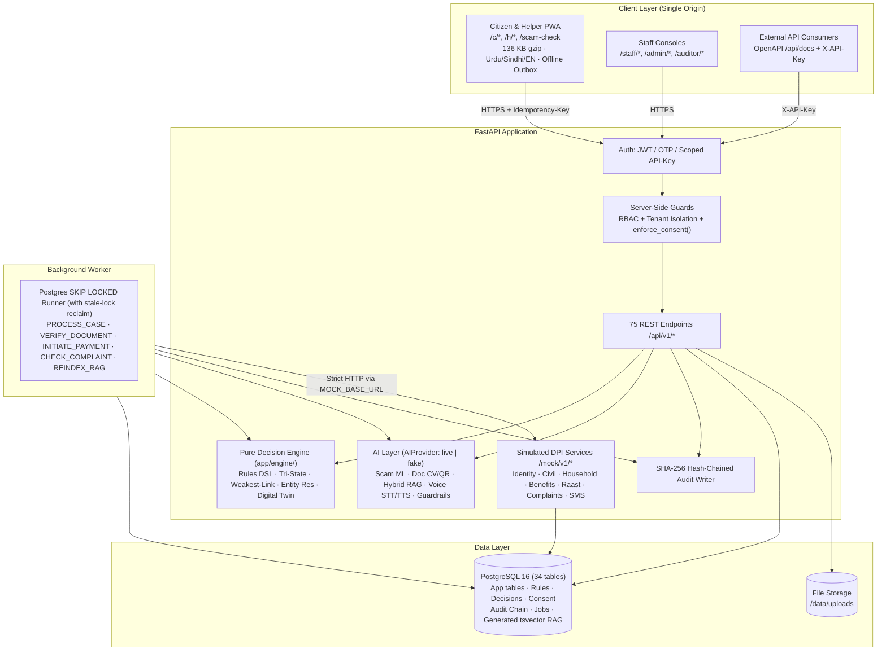

# Haqdaar (حقدار) - To Every Rightful Person, Safely

> **PROTOTYPE - THIS IS NOT AN OFFICIAL GOVERNMENT SERVICE.** Haqdaar was built during the Coder's Cup 2026 hackathon as a working prototype. **Every identity, civil-registry, household-survey, benefits, payment, complaint, and SMS service it talks to is simulated** and lives under `/mock/v1/*`; no request ever reaches a real registry, bank, or telecom. **All data is 100 % synthetic**: every citizen, case, phone number, and document is fictional, and **every CNIC in this repository starts with the fictional prefix `99900`**. **Every generated card image is watermarked `MOCK SPECIMEN`.** No real personal data was used at any point, and nothing here should be presented to a citizen as a real entitlement.

---

### At a Glance - Verified Numbers (100% Green CI)

| Dimension | Verified Result | How It Is Proven |
|---|---|---|
| **Automated Test Suite** | **1,162 / 1,162 passing** (`0` failures, `ruff` `0` errors) | GitHub Actions CI (`postgres:16` + `pytest` + `ruff`) |
| **Functional AI Features** | **5 distinct AI systems** (rubric requires ≥ 3) | Scam ML + Doc CV/QR + Policy RAG + Voice STT/TTS + Case Agent |
| **Scam Classifier** | **0.9444 F1 · 0.9444 Precision · 0.04 FPR · 0.00 Hard-Neg FPR** | Held-out test set (`[[24, 1], [1, 17]]`), `GET /api/v1/eval/dashboard` |
| **Document Verifier** | **100% genuine · 100% forged caught · 0.00% false-tamper** | 30-image eval set (clean, WhatsApp-compressed, forged, blurry) |
| **Decision Router Safety** | **0.0% false approvals** at `τ = 0.90` · **`AUTO_REJECT` absent** | 133-case cost-matrix sweep + `test_no_auto_reject_route_action_exists` |
| **Inclusion & Regional Languages** | **Urdu (`ur`, default) + Sindhi (`sd`, سنڌي) + English (`en`)** | RTL, 73 Urdu MP3s, voice on every wizard step + Policy Q&A, Auto-Read, WCAG AA ≥ 5.4:1 |
| **2G / Weak-Internet PWA** | **138.7 KB gzipped** (`≤ 150 KB` budget) · **63 precache entries (1,218 KiB)** | Local production build and `npm run budget`, Dexie offline outbox + `Idempotency-Key`, Lite Mode |
| **Multi-Tenant SaaS & API** | **75 `/api/v1` endpoints** (85 total ops) · **5 RBAC roles** · **34 DB tables** | Strict JWT RBAC on every route, tenant isolation (`404` anti-leak), SHA-256 audit chain |

---

## 1. Judge's 100-Point Rubric Guide

Everything below maps directly to **`docs/AI_Hackathon_Evaluation_Rubrics.pdf`** (all 6 categories / 21 criteria). For deep code-level traceability and exact commands per criterion, see [`docs/18-rubric-traceability.md`](docs/18-rubric-traceability.md).

### Category 1 - AI Implementation & Intelligence (30 pts)
- **5 Distinct Functional AI Systems (12 pts - ≥ 3 required):**
  1. **Hybrid Anti-Scam Engine** (`app/ai/scam_classifier.py`, `/scam-check`): Accepts **text, screenshot OCR, or voice note**. Stage 1 verifies official `HQ-XXXXX` codes against cryptographic `body_sha256` with a numeric-tampering guard; Stage 2 runs deterministic fraud red flags; Stage 3 runs a `FeatureUnion(word 1–2 + char_wb 3–5)` TF-IDF + calibrated Logistic Regression classifier (**0.9444 F1**, **0.04 FPR**, **0.00 hard-negative FPR**).
  2. **Cryptographic Document Verifier** (`app/ai/doc_verify.py`, `app/agent/assemble.py`): OpenCV Laplacian blur check + `QRCodeDetector` + `HMAC-SHA256` signature verification + Vision OCR cross-check (`ocr_vs_qr`). Forged/Photoshopped cards reliably propagate a `TAMPER_SUSPECTED` (`HIGH`) flag that forces four-eyes officer approval; re-compressed genuine cards stay `VERIFIED`/`UNVERIFIABLE` (**0.00% false-tamper**).
  3. **Grounded Bilingual Policy RAG Assistant** (`app/ai/rag.py`, `/c/ask`): Hybrid Postgres generated `tsvector` + NumPy cosine retrieval (no `pgvector` dependency, dimension-mismatch resilient) with **text AND voice input** (`POST /api/v1/rag/transcribe`), section-pure citations, two-gate abstention (`NOT_SURE` with zero LLM calls below similarity/coverage gates), and PII/injection/personal-claim guardrails.
  4. **Urdu Voice Pipeline** (`app/ai/voice.py`, `app/ai/urdu_nlp.py`): Deepgram `nova-3` transcribes Urdu for the wizard and policy Q&A. The wizard parses supported fields, reads values back, and lets citizens retry or use the keypad. Deepgram Flux supplies prerecorded Urdu prompts and synthesizes dynamic Urdu audio.
  5. **Autonomous Case Agent + Pure-Python Policy Engine** (`app/agent/case_agent.py`, `app/engine/`): Calls simulated DPI services over HTTP, resolves misspelled Pakistani names via phonetic canonicalization + RapidFuzz, assembles tri-state facts, evaluates live DB rule versions, computes 4-pillar weakest-link confidence, and generates a structured AI handoff note for officers.
- **Deep Workflow Integration & Quality (14 pts):** Every AI call sits directly inside the case state machine, is audited in `audit_events`, metered per-task in `ai_telemetry` (latency, tokens, USD cost, failure rate), guarded by `app/ai/guardrails.py`, and degrades cleanly via strict `AIProvider` (`live | fake`).
- **Deliberate Model & Tool Selection (4 pts):** Hybrid TF-IDF + logistic regression for the small scam dataset (0.9444 F1 on 43 held-out messages); signed HMAC QR and OpenCV for document checks; Postgres `tsvector` and NumPy cosine search for policy retrieval; cached Urdu prompts to limit network requests. Design rationale in [`docs/07-ai-components.md`](docs/07-ai-components.md).

### Category 2 - SaaS Functionality & Technical Architecture (20 pts)
- **Complete Multi-Tenant SaaS (8 pts):** 5 roles (`CITIZEN`, `HELPER`, `OFFICER`, `ADMIN`, `AUDITOR`), strict JWT RBAC enforced on every non-public route (automated route-table invariant test), `tenant_id` derived exclusively from JWT (foreign tenant/citizen IDs return `404` to prevent existence leaks), versioned JSON-DSL rules, Officer Queue with four-eyes approval (`403 SAME_OFFICER`) & citizen registry-correction resolution, Admin console (Rules + Digital Twin, Users, Reveal-Once scoped & rate-limited API keys, Mock chaos control, Jobs & Live System Health), and Auditor console (hash-chain verification, consent log, decision trace).
- **Clean Layered Backend & API (5 pts):** **75 `/api/v1` endpoints** (85 total ops) across 21 modules, Pydantic v2 validation, structured bilingual error codes (`CONSENT_REVOKED`, `INVALID_TRANSITION`, `SAME_OFFICER`, `IDEMPOTENCY_CONFLICT`), `Idempotency-Key` replay/conflict handling, `ETag` conditional GETs, CORS + security headers, proxy-aware rate limiting, and OpenAPI at `/api/docs` & `/api/openapi.json`.
- **PostgreSQL 16 Data Architecture (4 pts):** 27 application tables + 7 isolated mock tables across 4 linear Alembic migrations; transactional broker-free job queue (`SELECT ... FOR UPDATE SKIP LOCKED` with stale-lock recovery); `pg_advisory_xact_lock`-serialized SHA-256 audit hash chain; generated `tsvector` column; stored tri-state facts; DB-backed idempotency & worker heartbeats.
- **CI, Testing & Observability (3 pts):** 3-job GitHub Actions CI (`Backend - ruff + pytest` with Postgres 16, `Frontend - typecheck + build + budget`, `Architectural invariants`) - **all 1,162 tests green**; `GET /health`, `GET /metrics` (Prometheus), `GET /api/v1/eval/dashboard` (live AI telemetry by task + guardrail counts), structured JSON logs with `X-Request-ID`, and `docker-compose.yml` with healthchecks.

### Category 3 - Real-World Problem Solving (15 pts)
- **Grounded in Sindh's Real Failure Modes (5 pts):** Designed around a widowed woman in Thatta who may not read forms, uses a dropping 2G phone, faces misspelled/missing government records, needs a trusted village helper serving 40 families on one phone, and is targeted by fake relief-payment scams.
- **Full End-to-End Task Completion (7 pts):** Complete working journeys - not mocked UI slides:
  - Citizen voice/icon offline application → document upload & CV/QR verification → background DPI lookup → policy evaluation → officer four-eyes review → simulated Raast payout → `HQ-XXXXX` SMS verification → `PAID` (plus free complaint escalation, consent withdrawal/re-grant, and data export/correction).
  - Helper multi-family roster → add new family (OTP or witnessed verbal audio) → zero-leak family switching (cache + IndexedDB wipe) → OTP consent renewal on locked families.
- **Quantified Practical Impact (3 pts):** At `τ = 0.90` on the 133-case benchmark, **55.6%** of cases auto-approve in **16 ms p50** with **0.0% false approvals** (expected cost **451** vs **2,011** at `τ = 0.50`), freeing officers for the uncertain minority.

### Category 4 - Accessibility & Inclusion (10 pts)
- **Voice & Regional Language Support (4 pts):** Urdu, Sindhi, and English interface options, with RTL layouts for Urdu and Sindhi. Urdu voice support includes prerecorded prompts, speech input on supported application fields and policy Q&A, and readback. **Auto-Read** is available from the citizen header.
- **Low-Literacy Usability (3 pts):** One question per screen, ≥48 px tap targets (56 px primary), WCAG AA `≥ 5.4:1` contrast, **Approximate Age quick-picker** (`~25 / ~35 / ~45 / ~55 / ~65`), visual **Income Band tier bars**, custom digit pad, readback confirmation (including voice `"I don't know"`), and copyable reference codes everywhere.
- **Weak Internet & 2G Resilience (3 pts):** **136.0 KB gzipped** initial JS bundle (CI-enforced `≤ 150 KB`), Workbox precache trimmed 61% to **59 entries (1.0 MB)** with lazy `CacheFirst` audio caching, Dexie IndexedDB autosave & outbox preserving `X-Act-For-Citizen` + failed-sync **Retry / Discard** recovery controls, `ETag` 304 responses, and **Lite Mode** that actively pauses background polling and suppresses `.webp` illustrations.

### Category 5 - Safety, Privacy & Reliability (15 pts)
- **AI Uncertainty & Human Handoff (5 pts):** Tri-state canonical facts (`KNOWN`/`UNKNOWN` with `missing_reason`), **no `AUTO_REJECT` anywhere** (`PROCESSING → REJECTED` raises `409 INVALID_TRANSITION`), 4-pillar weakest-link confidence (`min`, never average), structured AI handoff notes, `CANNOT_TELL` scam band, `NOT_SURE` RAG abstention, and `WAITING_EXTERNAL` when registries fail.
- **Privacy, Consent & Data Protection (4 pts):** Per-purpose consent grants with 1-tap withdrawal (`ON_HOLD_CONSENT`, never rejected) and 1-tap re-grant; `enforce_consent()` on every citizen-data read commits denied `consent_access_logs` + `audit_events` in an **isolated DB session before raising `403 CONSENT_REVOKED`**; isolated-session OTP attempt persistence (blocks brute-force rollback) + phone/purpose binding; citizen JSON data export (`/c/my-data`); zero raw PII in logs or auditor traces; 100% synthetic `99900` CNICs.
- **Explainability & Auditability (3 pts):** Plain-language 3-bullet citizen explanations (Urdu/English, no rule IDs), full officer fact table + rule trace + 4-pillar bottleneck view, and auditor SHA-256 hash chain (`GET /api/v1/auditor/verify-chain` returns exact `first_broken_seq`).
- **Risk Handling & System Reliability (3 pts):** Chaos-tested mock DPI services (`NORMAL | SLOW | FLAKY | DOWN` + malformed JSON recovery in `MockClient`), `AIProvider` fallback, idempotent offline writes, stale-job lock reclaim, and job post-conditions preventing cases from ever getting stuck in `PROCESSING`.

### Category 6 - Innovation & Creativity (10 pts)
- **Digital Twin Policy Simulator (`/admin/rules`):** Replays historical decisions against a draft rule version before publishing, displaying exact **flipped cases, budget delta (PKR), and a route-shift transition matrix**.
- **Interactive Expected-Cost Threshold Explorer (`/staff/eval`):** Live clickable U-curve visualizing the Bayes cost tradeoff across `τ = 0.50..0.95` alongside live per-task AI telemetry and calibrated scam confusion matrix.
- **4-Pillar Weakest-Link Bottleneck View (`/staff/cases/:id`) & Calibrated Scam Risk Gauge (`/scam-check`):** Turns opaque ML/rule scores into immediate human-verifiable evidence.
- **Built-in Device Simulator (`/staff/device-sim`):** Lets a judge inspect live synthetic OTPs, `HQ-XXXXX` verification codes, and `body_sha256` hashes side-by-side with no second phone.
- **Zero-Broker Transactional Queue + Extension-Free Hybrid RAG + Automated Architectural Invariant Scanner:** Engineering rigor enforced in CI, not slides.

---

## 2. 3-Minute Judge Walkthrough (Live Demo)

No setup or external phone required - log in with one click on `/login` (`DEMO_MODE=true`):

| Minute | Persona / Route | What to Try & What It Proves |
|---|---|---|
| **0:00–0:45** | `widow_fatima` → `/c` | Switch **اردو / سنڌي / EN**, toggle **Auto-Read** & **Lite Mode**, open the wizard (`/c/apply/...`), use **🎤 Voice input** or **Approximate Age / Income Bands**, try `"I don't know"`, and test offline submit (queues safely in IndexedDB outbox). |
| **0:45–1:15** | Public → `/scam-check` | No login needed. Paste a fake fee/PIN SMS, upload a screenshot, or record voice → see the **Calibrated Risk Band Gauge** and red flags. Paste a real `HQ-XXXXX` SMS from `/staff/device-sim` → `VERIFIED_OFFICIAL`; edit the PKR amount by 1 digit → numeric-tampering guard catches the forgery! |
| **1:15–1:45** | `widow_fatima` → `/c/consent` & `/c/my-data` | Withdraw consent for `helper_ayesha` (or department), switch to `helper_ayesha` and try viewing Fatima → **blocked (`403 CONSENT_REVOKED`)**, then look at Fatima's **Access Log**: the blocked attempt is persisted! Click **Download my data (JSON)** or **Grant access again** to auto-resume held cases. |
| **1:45–2:15** | `officer_sana` → `/staff/queue` & `/staff/cases/:id` | Inspect a `TAMPER_SUSPECTED` / `HIGH` case: see the **4-Pillar Weakest-Link Confidence Breakdown** (bottleneck highlighted), **Rule Trace**, **AI Handoff Note**, and **Agent Steps**. Approve once → moves to `PENDING_SECOND_APPROVAL`; try approving again as Sana → blocked (`403 SAME_OFFICER`) until `officer_imran` records second approval! |
| **2:15–2:45** | `admin_bilal` → `/admin/rules` & `/staff/eval` | Edit an eligibility rule or threshold and click **Run Digital Twin** → preview flipped citizens, PKR budget delta, and **Route-Shift Transition Matrix** before publishing. Open `/staff/eval` → click thresholds on the **Interactive Cost U-Curve** and inspect **Live AI Telemetry by Task**. |
| **2:45–3:00** | `auditor_nadia` → `/auditor/events` & `/transparency` | Click **Verify Hash Chain** to prove tamper-evident SHA-256 audit integrity, inspect any full decision trace, and visit `/transparency` for the honest 11-row **Real vs. Simulated** disclosure. |

---

### Follow a case from submission to notification

1. Sign in as demo citizen Fatima and submit an application with `fatima_cnic_forged_name.jpg` and the genuine synthetic death certificate. The CNIC specimen intentionally has a printed name that differs from its QR data. Show the voice transcript, confirm or correct the parsed value, then note the case reference in **My cases**.
2. Sign in as Officer Sana and find that reference in **Cases to review** after the background checks finish. Compare the case summary with the evidence and document checks. Select **Start review**. If you need to start at the review step, use seeded case `HQ-2026-000101` and follow that reference for the rest of the demo.
3. Select **Approve** and **Save decision**. Show **Awaiting second approval** and point out that Sana cannot approve a second time. Sign in as Officer Imran and record the second approval.
4. Once the background worker processes the simulated payout, open **Device Simulator** and look for the notification for the approved case. Use its verification code in the scam checker to show how a citizen can verify the message.

The registry checks, payout, and SMS delivery are simulated. The queue, decisions, and audit trail are recorded by the application.

### Sindhi speech

Select **سنڌي** in the language menu. The application microphone, its transcription preview, and the Ask microphone use Deepgram Nova-3 with `language=sd`. The wizard still requires confirmation before accepting a dictated value. In Ask, Sindhi dictation fills the editable question field. Policy answers currently use the Urdu answer path.

For live Sindhi playback, enable the Cloud Text-to-Speech API on a Google Cloud billing project. Set `AI_PROVIDER=live`, `DEEPGRAM_API_KEY`, `GOOGLE_CLOUD_PROJECT`, and `GOOGLE_TTS_ACCESS_TOKEN` in the ignored root `.env`. The Google token is a short-lived OAuth token with the cloud-platform scope. With Google Cloud CLI application default credentials configured, obtain it with `gcloud auth application-default print-access-token`. Restart the backend or recreate the API container after updating the token.

For offline instructions, place reviewed native-speaker MP3 bytes under `frontend/public/audio/sd/` with the `.clip` suffix, such as `wizard_welcome.clip`. The app plays those assets in the browser and the PWA caches them. Check the recordings and Gemini's Sindhi pronunciation with a Pakistani Sindhi speaker using synthetic examples before a judge demo.

### Evidence to capture before judging

Use only synthetic records and watermarked specimens. Record the commit, device, network profile, and whether the providers were live or simulated beside each result.

| Rubric area | Rehearsal | Evidence to keep |
|---|---|---|
| AI quality | Dictate a synthetic CNIC, date of birth, payout phone, and income. Ask a supported policy question, then an off-topic question. | Exact field matches before correction, successful readback, retries, response times, and whether the answer's source supports it. Report the number of attempts. |
| Accessibility | On a phone-width screen, select Sindhi and check the translated controls. Use Urdu audio and readback. On a throttled connection, go offline after the app loads, submit once, then reconnect. | Time until the first screen is usable, the queued status, and one server-side case after reconnecting. Label Urdu speech separately from the Sindhi interface. |
| Reliability and privacy | Withdraw a demo helper's consent and repeat a read. With the mock registry down, submit a separate case, then restore the mock. | Blocked read in the access log, the case's waiting state, recovery after the worker retries, and the audit verification result. Use a disposable demo database for this rehearsal. |
| Practical impact | Have a teammate unfamiliar with the app complete the application and verify a suspicious SMS without coaching. | Completion time, whether each task was completed, and where help was needed. Report this as a small usability rehearsal. |
| Innovation | Simulate an eligibility rule change before publishing it. | Cases that change outcome, the estimated budget impact, and the rule version on an earlier decision. |

For the Docker rehearsal, start with `AI_PROVIDER=fake` and `ANAM_ENABLED=false`. For the live Urdu speech rehearsal, set `AI_PROVIDER=live` and configure `DEEPGRAM_API_KEY` in the root `.env`. Live policy Q&A also uses `OPENAI_API_KEY`. If you want live video, enable Anam and set `ANAM_API_KEY` there. Recreate the containers after changing their environment. Before the demo, confirm the worker heartbeat in `/health` as well as the HTTP status.

In a local API smoke check, Deepgram Nova-3 transcribed the repository's Urdu submission confirmation clip exactly in 1.58 seconds. A dynamic Urdu sentence returned an MP3. The document requirements question returned a cited answer through the deterministic fallback, and the weather question returned `NOT_SURE` with no citations. These are individual API checks. Measure human speech across multiple recordings and run the same scenarios on the judge deployment before reporting accuracy or latency figures.

Three generated Urdu clips also went through the live application field parser. It matched the expected income and date of birth. The CNIC transcription contained an extra digit, and the parser requested a retry. The sample is too small to estimate accuracy, but it demonstrates why the numeric keypad and readback matter.

## 3. The Problem & Personas

> We help widowed women in low-income Sindh households claim and safely receive the (fictional) Sahara Widow Support Grant, even though they cannot read the forms, have weak and dropping mobile signal, have records that are misspelled or incomplete across government systems, and are targeted by fake "relief payment" scam messages.

| Persona | Who they are | What breaks for them today | What that forces us to build |
|---|---|---|---|
| **Widow** | Cannot read the forms; weak, dropping signal | Text-heavy forms, one-shot submissions, no feedback when the network dies | Voice + icon-first wizard (Urdu & Sindhi), one question per screen, saved progress, true offline submit |
| **Shopkeeper** | Receives fake "relief payment" messages | No way to tell a real SMS from a forged one | Scam checker (text/screenshot/voice) with calibrated risk gauge, honest `CANNOT_TELL`, and cryptographic `HQ-*` codes |
| **Helper** | Serves ~40 families from one shared phone | Shared device leaks one family's data into the next | Two-tap family switching with full cache + IndexedDB wipe, per-family OTP/verbal consent, and consent renewal |

---

## 4. The Eight Domain Challenges

| # | Challenge | Our engineering answer | Where you see it live |
|---|---|---|---|
| **01** | The cost of being wrong | Wrong approval costs **100**, needless review **8**, extra question **5**: router acts alone only above `τ = 0.90`, and **`AUTO_REJECT` does not exist anywhere in the codebase**. | `/staff/eval` (interactive U-curve), `/staff/cases/:id` (four-eyes) |
| **02** | Saying "I am not sure" | Every uncertain path has a named state - `UNKNOWN` facts, `WAITING_EXTERNAL`, `CANNOT_TELL`, `NOT_SURE`, `POSSIBLE_DUPLICATE_IDENTITY` - handing a structured note to a human instead of guessing. | `/admin/mocks` (registry down → `WAITING_EXTERNAL`), `/scam-check`, `/c/ask` |
| **03** | Bad & misspelled data | Names pass Urdu Unicode normalization, transliteration, honorific stripping, Pakistani phonetic canonicalization (`Muhammad`/`Mohammad`/`Muhammed`), and RapidFuzz; name alone never matches. | `"Mst. Fatima Bibi"` vs `"Fatima Bibi"` in case trace |
| **04** | Rules that change | Rules live in `rule_versions.rules_json` evaluated by a pure DSL engine; Digital Twin simulates impact first; publishing flips `active_rule_version_id` atomically with zero restart. | `/admin/rules` (publish v2; v1 decisions retain v1 hash) |
| **05** | Explain and audit | Two views of every decision - 3 plain-language reasons for the citizen, and full trace (input snapshot hash, per-rule trace, 4 confidence pillars, agent timeline) over an append-only SHA-256 chain. | `/c/cases/:id`, `/auditor/events` (Verify Chain) |
| **06** | Consent and take-back | Single enforcement point `enforce_consent(...)` on every citizen-data read; withdrawal applies immediately, and denied attempts commit in an isolated DB session **before** raising `403`. | `/c/consent` (blocked access log + 1-tap re-grant) |
| **07** | Works for everyone | Urdu default + Sindhi (`sd`), icon-first wizard, ≥48 px targets, WCAG AA contrast, voice everywhere, Auto-Read, 136 KB bundle, 1.0 MB precache, IndexedDB outbox + Lite Mode. | `/c` (offline submit → replays once via `Idempotency-Key`) |
| **08** | Scams & fake documents | Official SMS carry `HQ-XXXXX` + `body_sha256` with numeric-tamper guard; documents verified by Laplacian blur + HMAC-signed QR + `ocr_vs_qr` cross-check (`0.00%` false-tamper on genuine cards). | `/scam-check`, `/staff/cases/:id` (`TAMPER_SUSPECTED` HIGH) |

---

## 5. Architecture



**LLM proposes, deterministic policy disposes.** Models read documents, transcribe speech, or draft explanations - they never decide eligibility. Eligibility lives in versioned DB rules evaluated by a 100% pure-Python engine (`backend/app/engine/`) with zero database, HTTP, or LLM imports (enforced by CI AST import scanning). If the external LLM provider goes down, applications still get decided accurately; only narration degrades.

**Unknown is a first-class value, and nothing is auto-rejected.** Canonical facts are tri-state (`KNOWN` / `UNKNOWN` with `missing_reason`) and never coerced to `0` or `false`. Confidence is the weakest link (`min`) across 4 pillars. The router has no `AUTO_REJECT` action; `PROCESSING → REJECTED` raises `409 INVALID_TRANSITION`, and only a human `OFFICER` can reject with explicit reason codes.

---

## 6. Real vs. Simulated Disclosure

Matches the exact eleven rows served by `GET /api/v1/transparency` and rendered at `/transparency`.

| Component | Real or Simulated? | Exact details |
|---|---|---|
| Auth, JWT, RBAC, Multi-Tenancy, Consent Engine, Audit Hash Chain | **REAL** | Enforced server-side in FastAPI + PostgreSQL 16 (Alembic migrations). |
| Versioned Rules Engine, Tri-State Evaluator, Entity Resolution, Confidence Router, Digital Twin | **REAL** | Pure Python deterministic engine (`app/engine/`) evaluating live DB rules. |
| Offline-First PWA & Idempotent Outbox | **REAL** | Workbox Service Worker + Dexie IndexedDB + server-side `Idempotency-Key` deduplication. |
| Scam Classifier & Official Verification Codes | **REAL** (trained on synthetic data) | Hybrid deterministic rules + calibrated `scikit-learn` word/char TF-IDF/LR model + cryptographic SMS `body_sha256` lookup. |
| Document Verification (Blur, Signed QR, OCR Cross-Check) | **REAL** (on mock specimens) | OpenCV Laplacian blur + `QRCodeDetector` + `HMAC-SHA256` signature + vision OCR comparison. |
| Urdu Voice STT/TTS, RAG Policy Q&A & Optional Video Guide | **REAL** (with `fake` mode) | Deepgram Nova-3 handles Urdu transcription, Deepgram Flux handles Urdu speech synthesis, and policy Q&A uses hybrid Postgres/NumPy retrieval with an OpenAI synthesis path and a deterministic fallback. The optional Anam video guide is informational. Conversational mode sends microphone audio to Anam, so use synthetic examples and avoid speaking personal details. Haqdaar keeps case decisions in its own workflow. Video steps down to audio-only guidance in Lite Mode or offline. |
| Identity Registry (NADRA-like) | **SIMULATED** | Mock REST API (`/mock/v1/identity/lookup`) with synthetic `99900-*` CNICs & chaos modes. |
| Civil Death, Household Survey & Benefits Registries | **SIMULATED** | Mock REST APIs (`/mock/v1/civil/*`, `/household/*`, `/benefits/*`) with synthetic data. |
| Instant Payment Rails (Raast-like) & Complaints | **SIMULATED** | Mock REST API (`/mock/v1/payments/*`, `/complaints`) with idempotent transfers & test failure alias. |
| SMS / OTP Delivery | **SIMULATED** | Stored in `notifications` & displayed live in `/staff/device-sim`; no real telecom gateway. |
| Citizens, Cases & Documents | **SYNTHETIC** | 100% fictional Pakistani personas and watermarked `MOCK SPECIMEN` cards. Zero real personal data. |

---

## 7. Verified Benchmarks & Engineering Metrics

Every figure below is measured from the running codebase and enforced by automated tests. Reproduce live at `GET /api/v1/eval/dashboard`.

### Cost-Sensitive Decision Router Sweep (`n = 133`, `eval_cases.jsonl`)

Cost matrix stored in `rule_versions.rules_json.policy.cost_matrix`: Wrong auto-approval = **100**, Unnecessary human review = **8**, Extra ask-more round = **5** (Bayes break-even `p > 0.92`; active operating point `τ = 0.90`).

| `τ` | Auto-approved | False approvals | Sent to a human | Expected cost |
|---|---|---|---|---|
| 0.50 – 0.70 | 78.2 % | 17.3 % | 16.5 % | 2011 |
| 0.75 | 74.4 % | 13.1 % | 20.3 % | 1551 |
| 0.80 | 70.7 % | 8.5 % | 24.1 % | 1091 |
| 0.85 | 62.4 % | 4.8 % | 32.3 % | 779 |
| **0.90 (active)** | **55.6 %** | **0.0 %** | **39.1 %** | **451** |
| 0.95 | 41.4 % | 0.0 % | 53.4 % | 603 |

### Scam Classifier (`scam-tfidf-lr-v1.0.0`)

| Metric | Verified Value |
|---|---|
| Architecture | Hybrid `FeatureUnion(word (1,2) + char_wb (3,5))` TF-IDF + `CalibratedClassifierCV(LogisticRegression)` + Stage-1 cryptographic `HQ-*` / `body_sha256` lookup |
| Train / held-out test set | 172 / 43 |
| Precision / Recall / F1 | **0.9444 / 0.9444 / 0.9444** |
| False-positive rate | **0.04** |
| Hard-negative FPR (benign money/bank/transfer messages) | **0.00** |
| Confusion matrix `[[TN, FP], [FN, TP]]` | `[[24, 1], [1, 17]]` |

### Document Verifier (`n = 30` synthetic specimens)

| Metric | Verified Value |
|---|---|
| Genuine cards verified | **100 %** |
| Forged cards caught (`TAMPER_SUSPECTED` → four-eyes) | **100 %** |
| False-tamper rate (including WhatsApp-compressed genuine cards) | **0.00 %** |
| Blurry cards routed to `NEEDS_RETAKE` | **100 %** |

### Automated Test Suite & PWA Bundle Budget

| Suite | Tests | Covers |
|---|---:|---|
| `backend/tests/engine` | 596 | Rules DSL, tri-state evaluator, entity resolution, confidence, router policy, digital twin, eval sweep |
| `backend/tests/ai` | 356 | Scam classifier, doc verifier, RAG, voice, guardrails, provider, rubric regression suite |
| `backend/tests/integration` | 95 | Golden path, rule versioning, audit chain, idempotency, chaos resilience, my-data, complaints, metrics |
| `backend/tests/mocks` | 69 | Simulated DPI services and seed integrity |
| `backend/tests/security` | 21 | RBAC matrix, tenant isolation (`404`), consent enforcement incl. isolated denied-log persistence |
| `backend/tests/test_conftest_heal.py` | 14 | Schema healing test harness |
| `backend/tests/test_invariants.py` | 11 | Engine purity, mock-import ban, RBAC-on-every-route, no auto-reject, no raw PII in logs, transparency |
| **Total Backend (CI Postgres 16)** | **1,162 passing** | **0 failures · `ruff check` 0 errors** |
| **Frontend Citizen Bundle** | **136.0 KB / 150.0 KB** | **90.7 % of budget · 59 precache entries (1.0 MB) · Sindhi lazy chunk 4.3 KB** |

---

## 8. Demo Accounts (One-Click on `/login`)

`POST /api/v1/auth/demo-login` (`{"persona_key": "..."}`) works only when `DEMO_MODE=true` (returns `404` in production-shaped deployments).

| Persona key | Role | Tenant | Password login (staff consoles) | Synthetic Phone |
|---|---|---|---|---|
| `widow_fatima` | CITIZEN | - | OTP via Device Simulator | `+923001000001` |
| `shopkeeper_rasool` | CITIZEN | - | OTP via Device Simulator | `+923001000002` |
| `helper_ayesha` | HELPER | - | `ayesha@helper.mock` / `Demo@2026` | - |
| `officer_sana` | OFFICER | SPD | `sana@spd.mock` / `Demo@2026` | - |
| `officer_imran` | OFFICER | SPD | `imran@spd.mock` / `Demo@2026` | - |
| `admin_bilal` | ADMIN | SPD | `bilal@spd.mock` / `Demo@2026` | - |
| `admin_platform` | ADMIN | - | `platform@haqdaar.mock` / `Demo@2026` | - |
| `auditor_nadia` | AUDITOR | - | `nadia@audit.mock` / `Demo@2026` | - |
| `officer_zakat` | OFFICER | ZWB | `tariq@zwb.mock` / `Demo@2026` | - |

Synthetic CNICs: `9990010000012` (Fatima), `9990010000021` (Rasool), `9990010000032` (Ayesha).

---

## 9. Quickstart & Verification

```bash
cp .env.example .env          # HOST_DB_PORT=5433, HOST_API_PORT=8010 by default
docker compose up --build     # db + api (auto-migrates & seeds) + worker
```

| Endpoint / Surface | URL |
|---|---|
| Web App (PWA + Staff Consoles) | http://127.0.0.1:8010/ |
| Swagger UI (OpenAPI) | http://127.0.0.1:8010/api/docs |
| OpenAPI JSON | http://127.0.0.1:8010/api/openapi.json |
| Health (DB, worker heartbeat, upload dir, AI provider) | http://127.0.0.1:8010/health |
| Prometheus Metrics | http://127.0.0.1:8010/metrics |
| Real vs. Simulated Disclosure | http://127.0.0.1:8010/transparency |
| Device Simulator (Live OTPs, `HQ-*` codes, `body_sha256`) | http://127.0.0.1:8010/staff/device-sim |

### Reproduce All CI Gates Locally

```bash
# Backend lint + invariants + full Postgres suite (AI_PROVIDER=fake needs zero API keys)
ruff check backend/app backend/tests
AI_PROVIDER=fake pytest --noconftest backend/tests/test_invariants.py -q
AI_PROVIDER=fake pytest backend/tests -q

# Frontend typecheck + production build + <= 150 KB bundle budget
npm --prefix frontend run typecheck
npm --prefix frontend run build
npm --prefix frontend run budget
```

Reset demo data cleanly anytime: `docker compose exec api python -m app.mocks.seed --reset` (or `POST /api/v1/admin/demo/reset` as `ADMIN`).

---

## 10. Links & Repository Layout

| Item | Link |
|---|---|
| Rubric Traceability (21 criteria / 100 pts) | [`docs/18-rubric-traceability.md`](docs/18-rubric-traceability.md) |
| Architecture Blueprint & ADRs | [`docs/00-index.md`](docs/00-index.md) · [`docs/17-decision-log.md`](docs/17-decision-log.md) |
| Backend Platform, Engine, AI & Mocks | [`backend/app/`](backend/app/) |
| Frontend PWA & Staff Consoles | [`frontend/src/`](frontend/src/) |
| Live Deployment | `<!-- PLACEHOLDER: deployed URL -->` |
| Demo Video & Slides | `<!-- PLACEHOLDER: video & slides links -->` |

```text
backend/
  app/
    main.py          FastAPI app, CORS/security headers, SPA fallback, /health, /metrics
    models/          27 app tables (SQLAlchemy 2.0 sync) + 4 Alembic migrations
    security/        JWT, isolated-session OTP, RBAC, SHA-256 audit chain, consent, idempotency
    jobs/            Postgres SKIP LOCKED worker with stale-lock recovery
    api/v1/          75 REST endpoints across 21 routers
    engine/          100% pure-Python rules DSL, tri-state, entity resolution, weakest-link, twin
    agent/           Case agent, fact assembly, strict HTTP MockClient
    ai/              AIProvider (live|fake), scam ML, OpenCV/QR verifier, hybrid RAG, voice, guardrails
    mocks/           7 simulated DPI services under /mock/v1/* + synthetic seed
  tests/             1,162 tests (engine, ai, integration, mocks, security, invariants)
frontend/            React 18 + Vite 5 + Tailwind + Workbox PWA (Urdu/Sindhi/EN) + Staff Consoles
docs/                Frozen architecture, API contracts, decision log & rubric traceability
docker-compose.yml   PostgreSQL 16 + API + background worker
```

---

Built during the Coder's Cup 2026 window (Fri 20 Nov 18:00 – Sun 22 Nov 18:00 PKT). All code original to the hackathon. Zero real personal data, zero real government services, zero real money.
