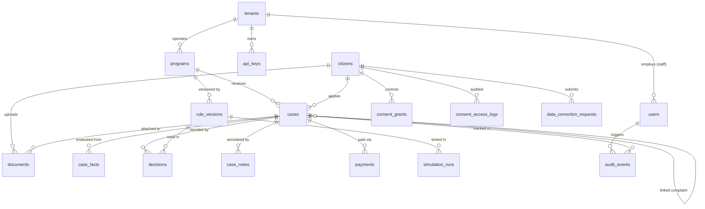

# 04 — Data Model, Database Schema & Canonical Facts

> **Status:** FROZEN v1.0. Source of truth for PostgreSQL tables, Alembic migrations, enums, case state machine, and canonical fact keys.
> **Owner:** A1 (migrations & ORM models), A2 (reads/writes via engine schemas), A3 (`mock_*` tables).

---

## 1. Schema Conventions

- **Primary Keys:** UUIDv4 (`UUID` column, generated application-side so IDs are known before flush and idempotent retries work cleanly).
- **Timestamps:** `TIMESTAMPTZ` in UTC (`created_at`, `updated_at`).
- **Multi-Tenancy:** Every tenant-scoped table includes `tenant_id UUID NOT NULL REFERENCES tenants(id)` with composite indexes `(tenant_id, ...)`. Platform-wide entities (citizens, global users, platform admins/auditors) have nullable or N/A `tenant_id`.
- **Immutability:** `rule_versions`, `decisions`, `audit_events`, and `consent_events` are **append-only** (never `UPDATE` or `DELETE` in application code).
- **Soft Deletion / Deactivation:** Users, API keys, and programs use `is_active BOOLEAN` or status enums; records are preserved for audit traceability.

---

## 2. Entity-Relationship Overview



---

## 3. Core Enums & Case State Machine

### 3.1 Role Enum (`user_role`)
`CITIZEN` | `HELPER` | `OFFICER` | `ADMIN` | `AUDITOR`

### 3.2 Case Type (`case_type`)
`BENEFIT_APPLICATION` | `COMPLAINT`

### 3.3 Case Status (`case_status`) & Allowed Transitions

| Status | Meaning | Citizen Display (en / ur summary) | Allowed Next Statuses |
|---|---|---|---|
| `DRAFT` | Saved wizard in progress, not yet submitted | Draft saved / درخواست محفوظ ہے | `SUBMITTED`, `WITHDRAWN` |
| `SUBMITTED` | Submitted; `PROCESS_CASE` job enqueued | Checking your application / جانچ جاری ہے | `PROCESSING`, `ON_HOLD_CONSENT` |
| `PROCESSING` | Agent actively calling mock services & rules | Checking your application / جانچ جاری ہے | `APPROVED`, `NEEDS_INFO`, `HUMAN_REVIEW`, `WAITING_EXTERNAL`, `ON_HOLD_CONSENT` |
| `WAITING_EXTERNAL` | A mock DPI service is down; retry scheduled | Waiting for government system / سرکاری نظام کا انتظار ہے | `PROCESSING`, `HUMAN_REVIEW`, `ON_HOLD_CONSENT` |
| `NEEDS_INFO` | Missing/blurry/unconfirmed info requested from citizen | Please provide more info / مزید معلومات درکار ہیں | `SUBMITTED` (resubmit), `HUMAN_REVIEW` (after 2 rounds), `ON_HOLD_CONSENT`, `WITHDRAWN` |
| `HUMAN_REVIEW` | Unassigned in officer queue ("I am not sure" / flagged) | Officer will check / افسر جانچ کرے گا | `IN_REVIEW`, `ON_HOLD_CONSENT` |
| `IN_REVIEW` | Assigned to a department officer | Officer is reviewing / افسر جائزہ لے رہا ہے | `APPROVED`, `PENDING_SECOND_APPROVAL`, `REJECTED`, `NEEDS_INFO`, `HUMAN_REVIEW` (unassign/escalate), `ON_HOLD_CONSENT` |
| `PENDING_SECOND_APPROVAL` | HIGH-risk approval awaits different officer (four-eyes) | Final check in progress / حتمی منظوری جاری ہے | `APPROVED`, `IN_REVIEW` (2nd officer returns), `REJECTED`, `ON_HOLD_CONSENT` |
| `ON_HOLD_CONSENT` | Citizen withdrew department consent while open | Paused — consent withdrawn / رضامندی واپس لی گئی | Restores `previous_status` on re-grant, or `WITHDRAWN` |
| `APPROVED` | Approved (auto or officer); payment job enqueued | Approved! Sending payment / منظور! رقم بھیجی جا رہی ہے | `PAYMENT_INITIATED`, `CLOSED` (for complaint) |
| `PAYMENT_INITIATED` | Mock Raast transfer sent | Sending payment / رقم بھیجی جا رہی ہے | `PAID`, `PAYMENT_FAILED` |
| `PAID` | Payment confirmed completed | Money sent / رقم موصول ہو گئی | `CLOSED` |
| `PAYMENT_FAILED` | Payment failed after retries; officer alerted | Payment issue — officer notified / ادائیگی میں مسئلہ | `PAYMENT_INITIATED` (retry), `HUMAN_REVIEW`, `CLOSED` |
| `REJECTED` | **Officer-only.** Rejected with reason codes | Not approved (see reasons) / منظور نہیں ہوئی | `CLOSED` |
| `WITHDRAWN` | Citizen withdrew draft/application | Withdrawn / واپس لے لی گئی | (terminal) |
| `CLOSED` | Final archived state | Completed / مکمل | (terminal) |

> **Hard Invariant:** Transition `PROCESSING -> REJECTED` is **illegal** and rejected at the service layer (`409 INVALID_TRANSITION`). Only an `OFFICER` can move a case to `REJECTED`.

### 3.4 Other Key Enums
- **Route Decision (`route_action`):** `AUTO_APPROVE` | `ASK_MORE` | `HUMAN_REVIEW` | `WAIT_EXTERNAL`
- **Document Type (`document_type`):** `CNIC_FRONT` | `SPOUSE_DEATH_CERTIFICATE` | `OTHER`
- **Document Verification Status (`doc_verify_status`):** `PENDING` | `VERIFIED` | `NEEDS_RETAKE` | `UNVERIFIABLE` | `TAMPER_SUSPECTED`
- **Consent Recipient Type (`consent_recipient_type`):** `DEPARTMENT` | `HELPER`
- **Consent Status (`consent_status`):** `ACTIVE` | `WITHDRAWN` | `EXPIRED`
- **Data Categories (`data_category`):** `IDENTITY` | `HOUSEHOLD` | `DOCUMENTS` | `PAYMENT` | `CASE_HISTORY`
- **Consent Purposes (`consent_purpose`):** `BENEFIT_APPLICATION` | `PAYMENT_DISBURSEMENT` | `HELPER_ASSISTANCE` | `COMPLAINT_RESOLUTION`
- **Scam Verdict (`scam_verdict`):** `VERIFIED_OFFICIAL` | `LIKELY_SAFE` | `CANNOT_TELL` | `LIKELY_SCAM`
- **Job Status (`job_status`):** `PENDING` | `RUNNING` | `COMPLETED` | `FAILED_RETRY` | `DEAD`

---

## 4. Relational Schema Specification

### 4.1 Identity, Tenants & Auth

#### `tenants`
| Column | Type | Constraints | Notes |
|---|---|---|---|
| `id` | UUID | PK | |
| `code` | VARCHAR(32) | UNIQUE NOT NULL | e.g. `SPD`, `ZWB` |
| `name` | VARCHAR(120) | NOT NULL | e.g. `Social Protection Department (Mock)` |
| `name_ur` | VARCHAR(120) | NOT NULL | Urdu display name |
| `is_active` | BOOLEAN | NOT NULL DEFAULT true | |
| `created_at` | TIMESTAMPTZ | NOT NULL | |

#### `users`
| Column | Type | Constraints | Notes |
|---|---|---|---|
| `id` | UUID | PK | |
| `tenant_id` | UUID | NULLABLE FK → `tenants.id` | NULL for Citizens, Helpers, Platform Admin, Platform Auditor |
| `role` | VARCHAR(20) | NOT NULL | `CITIZEN`, `HELPER`, `OFFICER`, `ADMIN`, `AUDITOR` |
| `email` | VARCHAR(160) | UNIQUE NULLABLE | Used by staff & helpers |
| `phone` | VARCHAR(20) | UNIQUE NULLABLE | Normalized `+923XXXXXXXXX`; used by citizens/helpers |
| `password_hash` | VARCHAR(255) | NULLABLE | Argon2/bcrypt hash (staff & helpers) |
| `full_name` | VARCHAR(120) | NOT NULL | |
| `preferred_lang` | VARCHAR(8) | NOT NULL DEFAULT `'ur'` | `'ur'` or `'en'` |
| `is_active` | BOOLEAN | NOT NULL DEFAULT true | |
| `created_at` | TIMESTAMPTZ | NOT NULL | |

#### `otp_challenges`
| Column | Type | Constraints | Notes |
|---|---|---|---|
| `id` | UUID | PK | |
| `phone` | VARCHAR(20) | NOT NULL INDEX | |
| `purpose` | VARCHAR(32) | NOT NULL | `LOGIN` or `HELPER_CONSENT` |
| `code_hash` | VARCHAR(128) | NOT NULL | SHA-256 of 6-digit OTP + salt |
| `attempts` | INT | NOT NULL DEFAULT 0 | Max 5 attempts |
| `expires_at` | TIMESTAMPTZ | NOT NULL | +5 minutes |
| `consumed_at` | TIMESTAMPTZ | NULLABLE | |
| `created_at` | TIMESTAMPTZ | NOT NULL | |

#### `refresh_tokens`
| Column | Type | Constraints | Notes |
|---|---|---|---|
| `id` | UUID | PK | |
| `user_id` | UUID | NOT NULL FK → `users.id` | |
| `token_hash` | VARCHAR(128) | UNIQUE NOT NULL | SHA-256 of opaque refresh token |
| `expires_at` | TIMESTAMPTZ | NOT NULL | |
| `revoked_at` | TIMESTAMPTZ | NULLABLE | |
| `created_at` | TIMESTAMPTZ | NOT NULL | |

#### `citizens`
| Column | Type | Constraints | Notes |
|---|---|---|---|
| `id` | UUID | PK | |
| `user_id` | UUID | UNIQUE NULLABLE FK → `users.id` | NULL if onboarded by helper without own login yet |
| `full_name` | VARCHAR(120) | NOT NULL | Self-declared display name |
| `cnic_digits` | VARCHAR(13) | NULLABLE INDEX | Normalized 13 digits (no dashes), synthetic range `99900...` |
| `phone` | VARCHAR(20) | NULLABLE INDEX | Contact phone (may be shared helper phone) |
| `district` | VARCHAR(64) | NULLABLE | |
| `dob` | DATE | NULLABLE | |
| `avatar_color` | VARCHAR(16) | NOT NULL DEFAULT `'#0F766E'` | Visual cue in Helper Mode |
| `profile_data` | JSONB | NOT NULL DEFAULT `'{}'` | Confirmed self-declared profile fields + history |
| `created_by_user_id` | UUID | NULLABLE FK → `users.id` | Set if created by a helper |
| `created_at` | TIMESTAMPTZ | NOT NULL | |
| `updated_at` | TIMESTAMPTZ | NOT NULL | |

#### `api_keys`
| Column | Type | Constraints | Notes |
|---|---|---|---|
| `id` | UUID | PK | |
| `tenant_id` | UUID | NOT NULL FK → `tenants.id` | |
| `name` | VARCHAR(80) | NOT NULL | Human label |
| `key_prefix` | VARCHAR(16) | NOT NULL INDEX | e.g. `hq_live_ab12cd34` |
| `key_hash` | VARCHAR(128) | UNIQUE NOT NULL | SHA-256 of full key |
| `scopes` | JSONB | NOT NULL | e.g. `["cases:read", "scam:check", "rules:read"]` |
| `rate_limit_per_min` | INT | NOT NULL DEFAULT 60 | |
| `is_active` | BOOLEAN | NOT NULL DEFAULT true | |
| `last_used_at` | TIMESTAMPTZ | NULLABLE | |
| `created_by_user_id` | UUID | NOT NULL FK → `users.id` | |
| `created_at` | TIMESTAMPTZ | NOT NULL | |

---

### 4.2 Programs & Versioned Rules

#### `programs`
| Column | Type | Constraints | Notes |
|---|---|---|---|
| `id` | UUID | PK | |
| `tenant_id` | UUID | NOT NULL FK → `tenants.id` | |
| `code` | VARCHAR(32) | UNIQUE NOT NULL | `SAHARA_WIDOW_GRANT`, `GUZARA_ALLOWANCE` |
| `name` | VARCHAR(120) | NOT NULL | |
| `name_ur` | VARCHAR(120) | NOT NULL | |
| `description` | TEXT | NOT NULL | |
| `description_ur` | TEXT | NOT NULL | |
| `required_documents` | JSONB | NOT NULL | e.g. `["CNIC_FRONT", "SPOUSE_DEATH_CERTIFICATE"]` |
| `wizard_schema` | JSONB | NOT NULL | Ordered step definitions for UI |
| `active_rule_version_id` | UUID | NULLABLE | Points to currently published `rule_versions.id` |
| `is_active` | BOOLEAN | NOT NULL DEFAULT true | |
| `created_at` | TIMESTAMPTZ | NOT NULL | |

#### `rule_versions` (APPEND-ONLY once `status = 'PUBLISHED'`)
| Column | Type | Constraints | Notes |
|---|---|---|---|
| `id` | UUID | PK | |
| `tenant_id` | UUID | NOT NULL FK → `tenants.id` | |
| `program_id` | UUID | NOT NULL FK → `programs.id` | |
| `version_number` | INT | NOT NULL | Monotonic per program (`1, 2, 3...`), UNIQUE `(program_id, version_number)` |
| `status` | VARCHAR(16) | NOT NULL | `DRAFT` \| `PUBLISHED` \| `ARCHIVED` |
| `rules_json` | JSONB | NOT NULL | Validated against Rules DSL schema ([06-decision-engine.md](06-decision-engine.md)) |
| `content_hash` | VARCHAR(64) | NOT NULL | SHA-256 of canonical sorted JSON of `rules_json` |
| `change_note` | TEXT | NULLABLE | Required when publishing |
| `created_by_user_id` | UUID | NOT NULL FK → `users.id` | |
| `published_by_user_id` | UUID | NULLABLE FK → `users.id` | |
| `published_at` | TIMESTAMPTZ | NULLABLE | |
| `created_at` | TIMESTAMPTZ | NOT NULL | |

#### `simulation_runs` (Digital Twin)
| Column | Type | Constraints | Notes |
|---|---|---|---|
| `id` | UUID | PK | |
| `tenant_id` | UUID | NOT NULL FK → `tenants.id` | |
| `program_id` | UUID | NOT NULL FK → `programs.id` | |
| `baseline_rule_version_id` | UUID | NOT NULL FK → `rule_versions.id` | |
| `candidate_rule_version_id` | UUID | NOT NULL FK → `rule_versions.id` | |
| `sample_size` | INT | NOT NULL | Number of historical cases replayed |
| `summary_json` | JSONB | NOT NULL | Outcome transition matrix, budget delta PKR, flipped case list |
| `created_by_user_id` | UUID | NOT NULL FK → `users.id` | |
| `created_at` | TIMESTAMPTZ | NOT NULL | |

---

### 4.3 Cases, Facts, Documents, Decisions & Payments

#### `cases`
| Column | Type | Constraints | Notes |
|---|---|---|---|
| `id` | UUID | PK | |
| `reference_code` | VARCHAR(20) | UNIQUE NOT NULL | Human-friendly e.g. `HQ-2026-000142` |
| `tenant_id` | UUID | NOT NULL FK → `tenants.id` | |
| `program_id` | UUID | NOT NULL FK → `programs.id` | |
| `citizen_id` | UUID | NOT NULL FK → `citizens.id` | |
| `submitted_by_user_id` | UUID | NOT NULL FK → `users.id` | Citizen or Helper |
| `submitted_via_helper` | BOOLEAN | NOT NULL DEFAULT false | |
| `case_type` | VARCHAR(24) | NOT NULL DEFAULT `'BENEFIT_APPLICATION'` | |
| `parent_case_id` | UUID | NULLABLE FK → `cases.id` | For `COMPLAINT` linked to an application |
| `status` | VARCHAR(32) | NOT NULL INDEX | Enum §3.3 |
| `previous_status` | VARCHAR(32) | NULLABLE | Used to resume after `ON_HOLD_CONSENT` |
| `assigned_officer_id` | UUID | NULLABLE FK → `users.id` | |
| `first_approver_id` | UUID | NULLABLE FK → `users.id` | For four-eyes enforcement |
| `priority_score` | INT | NOT NULL DEFAULT 0 | 0–100, computed on escalation/update |
| `priority_band` | VARCHAR(10) | NOT NULL DEFAULT `'NORMAL'` | `URGENT` \| `HIGH` \| `NORMAL` \| `LOW` |
| `latest_confidence` | NUMERIC(4,3) | NULLABLE | 0.000–1.000 for queue sorting |
| `latest_route` | VARCHAR(20) | NULLABLE | `AUTO_APPROVE` \| `ASK_MORE` \| `HUMAN_REVIEW` \| `WAIT_EXTERNAL` |
| `latest_rule_version_id` | UUID | NULLABLE FK → `rule_versions.id` | |
| `approved_amount_pkr` | INT | NULLABLE | Computed or officer-confirmed amount |
| `ask_more_rounds` | INT | NOT NULL DEFAULT 0 | Max 2 before forced `HUMAN_REVIEW` |
| `wizard_step` | VARCHAR(40) | NULLABLE | Saved progress pointer |
| `draft_answers` | JSONB | NOT NULL DEFAULT `'{}'` | Keyed by canonical fact key: `{value, confirmed, entered_by, missing_reason}` |
| `flags_json` | JSONB | NOT NULL DEFAULT `'[]'` | Active risk/anomaly flags `[{code, severity, detail}]` |
| `ai_case_note` | JSONB | NULLABLE | `{verified: [], uncertain: [], suggested_checks: [], summary_en, summary_ur}` |
| `citizen_explanation` | JSONB | NULLABLE | `{headline_ur, headline_en, reasons_ur: [], reasons_en: [], next_step_ur, next_step_en}` |
| `submitted_at` | TIMESTAMPTZ | NULLABLE | |
| `decided_at` | TIMESTAMPTZ | NULLABLE | |
| `created_at` | TIMESTAMPTZ | NOT NULL | |
| `updated_at` | TIMESTAMPTZ | NOT NULL | |

*Indexes:* `(tenant_id, status, priority_score DESC, created_at ASC)`, `(tenant_id, latest_confidence ASC)`, `(citizen_id, created_at DESC)`.

#### `documents`
| Column | Type | Constraints | Notes |
|---|---|---|---|
| `id` | UUID | PK | |
| `tenant_id` | UUID | NOT NULL FK → `tenants.id` | |
| `citizen_id` | UUID | NOT NULL FK → `citizens.id` | |
| `case_id` | UUID | NULLABLE FK → `cases.id` | |
| `doc_type` | VARCHAR(32) | NOT NULL | `CNIC_FRONT` \| `SPOUSE_DEATH_CERTIFICATE` \| `OTHER` |
| `storage_path` | VARCHAR(255) | NOT NULL | Relative path inside `UPLOAD_DIR` |
| `mime_type` | VARCHAR(64) | NOT NULL | |
| `size_bytes` | INT | NOT NULL | |
| `sha256_hash` | VARCHAR(64) | NOT NULL | File integrity hash |
| `verify_status` | VARCHAR(24) | NOT NULL DEFAULT `'PENDING'` | Enum §3.4 |
| `verify_confidence` | NUMERIC(4,3) | NULLABLE | |
| `extracted_fields` | JSONB | NOT NULL DEFAULT `'{}'` | `{cnic, full_name, dob, qr_payload, ocr_fields}` |
| `verify_checks` | JSONB | NOT NULL DEFAULT `'[]'` | `[{check, passed, value, threshold, detail}]` |
| `retake_reason_ur` | TEXT | NULLABLE | Spoken guidance if `NEEDS_RETAKE` |
| `retake_reason_en` | TEXT | NULLABLE | |
| `uploaded_by_user_id` | UUID | NOT NULL FK → `users.id` | |
| `created_at` | TIMESTAMPTZ | NOT NULL | |

#### `decisions` (APPEND-ONLY — Full Auditor Trace + Citizen Explanation)
| Column | Type | Constraints | Notes |
|---|---|---|---|
| `id` | UUID | PK | |
| `tenant_id` | UUID | NOT NULL FK → `tenants.id` | |
| `case_id` | UUID | NOT NULL FK → `cases.id` | |
| `decision_source` | VARCHAR(16) | NOT NULL | `AI_ENGINE` \| `OFFICER` \| `SECOND_OFFICER` |
| `actor_user_id` | UUID | NULLABLE FK → `users.id` | NULL for `AI_ENGINE` |
| `rule_version_id` | UUID | NOT NULL FK → `rule_versions.id` | |
| `rule_content_hash` | VARCHAR(64) | NOT NULL | Copied for self-contained audit proof |
| `input_snapshot_json` | JSONB | NOT NULL | Complete canonical facts + provenance at decision time |
| `input_snapshot_hash` | VARCHAR(64) | NOT NULL | SHA-256 of canonical JSON |
| `rule_trace_json` | JSONB | NOT NULL | Per-rule `{rule_id, result: PASS|FAIL|UNKNOWN, actual, expected, reason_ur, reason_en}` |
| `confidence_components` | JSONB | NOT NULL | `{identity, documents, data_consistency, consent_assurance, overall}` |
| `confidence_overall` | NUMERIC(4,3) | NOT NULL | Weakest-link score |
| `route_action` | VARCHAR(20) | NOT NULL | `AUTO_APPROVE` \| `ASK_MORE` \| `HUMAN_REVIEW` \| `WAIT_EXTERNAL` |
| `outcome_status` | VARCHAR(32) | NOT NULL | Resulting case status |
| `escalation_reasons` | JSONB | NOT NULL DEFAULT `'[]'` | Enumerated reason codes (Challenge 02) |
| `model_versions` | JSONB | NOT NULL DEFAULT `'{}'` | `{engine: "1.0.0", ocr: "...", stt: "...", explainer: "..."}` |
| `citizen_explanation` | JSONB | NOT NULL | Plain-language Urdu + English explanation |
| `computed_amount_pkr` | INT | NULLABLE | |
| `officer_reason_codes` | JSONB | NULLABLE | Required for officer decisions |
| `officer_note` | TEXT | NULLABLE | |
| `is_override` | BOOLEAN | NOT NULL DEFAULT false | True if officer disagreed with prior AI recommendation |
| `created_at` | TIMESTAMPTZ | NOT NULL | |

#### `case_notes`
| Column | Type | Constraints | Notes |
|---|---|---|---|
| `id` | UUID | PK | |
| `tenant_id` | UUID | NOT NULL FK → `tenants.id` | |
| `case_id` | UUID | NOT NULL FK → `cases.id` | |
| `author_user_id` | UUID | NULLABLE FK → `users.id` | NULL for system/agent notes |
| `note_type` | VARCHAR(24) | NOT NULL | `AGENT_STEP` \| `AI_HANDOFF` \| `OFFICER_NOTE` \| `CITIZEN_REPLY` |
| `body` | TEXT | NOT NULL | |
| `metadata_json` | JSONB | NOT NULL DEFAULT `'{}'` | Tool name, latency, status for `AGENT_STEP` |
| `is_visible_to_citizen` | BOOLEAN | NOT NULL DEFAULT false | |
| `created_at` | TIMESTAMPTZ | NOT NULL | |

#### `payments`
| Column | Type | Constraints | Notes |
|---|---|---|---|
| `id` | UUID | PK | Also used as idempotency key to mock Raast |
| `tenant_id` | UUID | NOT NULL FK → `tenants.id` | |
| `case_id` | UUID | UNIQUE NOT NULL FK → `cases.id` | **Guarantees max 1 payment per case** |
| `citizen_id` | UUID | NOT NULL FK → `citizens.id` | |
| `amount_pkr` | INT | NOT NULL | |
| `payout_alias` | VARCHAR(32) | NOT NULL | Raast mobile alias |
| `status` | VARCHAR(20) | NOT NULL | `CREATED` \| `INITIATED` \| `COMPLETED` \| `FAILED` |
| `external_ref` | VARCHAR(64) | NULLABLE | Reference returned by mock Raast |
| `failure_reason` | VARCHAR(120) | NULLABLE | |
| `attempt_count` | INT | NOT NULL DEFAULT 0 | |
| `created_at` | TIMESTAMPTZ | NOT NULL | |
| `updated_at` | TIMESTAMPTZ | NOT NULL | |

---

### 4.4 Consent, Data Corrections & Audit

#### `consent_grants`
| Column | Type | Constraints | Notes |
|---|---|---|---|
| `id` | UUID | PK | |
| `citizen_id` | UUID | NOT NULL FK → `citizens.id` | |
| `recipient_type` | VARCHAR(16) | NOT NULL | `DEPARTMENT` \| `HELPER` |
| `recipient_tenant_id` | UUID | NULLABLE FK → `tenants.id` | Set when `DEPARTMENT` |
| `recipient_user_id` | UUID | NULLABLE FK → `users.id` | Set when `HELPER` |
| `categories` | JSONB | NOT NULL | Array of `data_category` |
| `purposes` | JSONB | NOT NULL | Array of `consent_purpose` |
| `status` | VARCHAR(16) | NOT NULL | `ACTIVE` \| `WITHDRAWN` \| `EXPIRED` |
| `assurance_level` | VARCHAR(20) | NOT NULL | `SELF_OTP` \| `CITIZEN_OTP` \| `VERBAL_WITNESSED` |
| `verbal_audio_path` | VARCHAR(255) | NULLABLE | Stored audio if `VERBAL_WITNESSED` |
| `granted_at` | TIMESTAMPTZ | NOT NULL | |
| `expires_at` | TIMESTAMPTZ | NULLABLE | Default +90 days for `HELPER` |
| `withdrawn_at` | TIMESTAMPTZ | NULLABLE | |
| `updated_at` | TIMESTAMPTZ | NOT NULL | |

#### `consent_events` (APPEND-ONLY)
| Column | Type | Constraints | Notes |
|---|---|---|---|
| `id` | UUID | PK | |
| `grant_id` | UUID | NOT NULL FK → `consent_grants.id` | |
| `citizen_id` | UUID | NOT NULL FK → `citizens.id` | |
| `action` | VARCHAR(20) | NOT NULL | `GRANTED` \| `MODIFIED` \| `WITHDRAWN` \| `EXPIRED` |
| `actor_user_id` | UUID | NOT NULL FK → `users.id` | |
| `snapshot_json` | JSONB | NOT NULL | Categories, purposes, status after event |
| `created_at` | TIMESTAMPTZ | NOT NULL | |

#### `consent_access_logs` (APPEND-ONLY — Shown to Citizen!)
| Column | Type | Constraints | Notes |
|---|---|---|---|
| `id` | UUID | PK | |
| `citizen_id` | UUID | NOT NULL FK → `citizens.id` | |
| `actor_user_id` | UUID | NULLABLE FK → `users.id` | NULL for `AGENT`/`SYSTEM` actors (ADR-019; mirrors `audit_events.actor_id` semantics) |
| `actor_role` | VARCHAR(20) | NOT NULL | |
| `actor_label` | VARCHAR(120) | NOT NULL | e.g. `"Helper Ayesha"` or `"Social Protection Dept"` |
| `tenant_id` | UUID | NULLABLE | |
| `category` | VARCHAR(24) | NOT NULL | |
| `purpose` | VARCHAR(32) | NOT NULL | |
| `resource_ref` | VARCHAR(80) | NOT NULL | e.g. `case:HQ-2026-000142` |
| `allowed` | BOOLEAN | NOT NULL | `true` or `false` (denied attempts MUST be logged!) |
| `denial_reason` | VARCHAR(64) | NULLABLE | e.g. `CONSENT_REVOKED`, `CATEGORY_NOT_GRANTED`, `CONSENT_EXPIRED` |
| `created_at` | TIMESTAMPTZ | NOT NULL | |

#### `data_correction_requests`
| Column | Type | Constraints | Notes |
|---|---|---|---|
| `id` | UUID | PK | |
| `citizen_id` | UUID | NOT NULL FK → `citizens.id` | |
| `tenant_id` | UUID | NULLABLE FK → `tenants.id` | |
| `field_key` | VARCHAR(48) | NOT NULL | Canonical fact key |
| `source_type` | VARCHAR(16) | NOT NULL | `SELF_DECLARED` \| `REGISTRY` |
| `old_value` | JSONB | NULLABLE | |
| `requested_value` | JSONB | NOT NULL | |
| `reason` | TEXT | NULLABLE | |
| `status` | VARCHAR(20) | NOT NULL | `APPLIED` \| `PENDING_OFFICER` \| `APPROVED` \| `REJECTED` |
| `reviewed_by_user_id` | UUID | NULLABLE FK → `users.id` | |
| `created_at` | TIMESTAMPTZ | NOT NULL | |

#### `audit_events` (APPEND-ONLY, HASH-CHAINED)
| Column | Type | Constraints | Notes |
|---|---|---|---|
| `seq` | BIGSERIAL | UNIQUE NOT NULL | Strict global monotonic sequence for chain order |
| `id` | UUID | PK | |
| `tenant_id` | UUID | NULLABLE INDEX | |
| `actor_type` | VARCHAR(16) | NOT NULL | `USER` \| `AI` \| `AGENT` \| `SYSTEM` \| `API_KEY` |
| `actor_id` | VARCHAR(64) | NULLABLE | User ID, API Key ID, or agent name |
| `actor_role` | VARCHAR(20) | NULLABLE | |
| `action` | VARCHAR(64) | NOT NULL INDEX | e.g. `case.submitted`, `agent.step`, `decision.recorded`, `consent.withdrawn`, `auth.forbidden` |
| `resource_type` | VARCHAR(32) | NOT NULL | `case`, `citizen`, `rule_version`, `consent_grant`, `payment`, `document`, `scam_check` |
| `resource_id` | VARCHAR(64) | NULLABLE INDEX | |
| `request_id` | VARCHAR(64) | NULLABLE | Correlation ID |
| `payload_json` | JSONB | NOT NULL | Redacted structured details (no raw PII secrets) |
| `prev_hash` | VARCHAR(64) | NOT NULL | `GENESIS` for `seq=1`, else `event_hash` of `seq-1` |
| `event_hash` | VARCHAR(64) | NOT NULL | `SHA256(prev_hash \| seq \| created_at_iso \| action \| resource_type \| resource_id \| canonical_payload)` |
| `created_at` | TIMESTAMPTZ | NOT NULL | |

---

### 4.5 AI, Notifications, Jobs & Idempotency

#### `notifications`
| Column | Type | Constraints | Notes |
|---|---|---|---|
| `id` | UUID | PK | |
| `tenant_id` | UUID | NULLABLE | |
| `citizen_id` | UUID | NULLABLE FK → `citizens.id` | |
| `user_id` | UUID | NULLABLE FK → `users.id` | |
| `phone` | VARCHAR(20) | NULLABLE INDEX | For simulated SMS inbox lookup |
| `channel` | VARCHAR(16) | NOT NULL | `IN_APP` \| `SMS_SIMULATED` |
| `title_ur` | VARCHAR(160) | NOT NULL | |
| `title_en` | VARCHAR(160) | NOT NULL | |
| `body_ur` | TEXT | NOT NULL | |
| `body_en` | TEXT | NOT NULL | |
| `verification_code` | VARCHAR(16) | UNIQUE NOT NULL | Format `HQ-XXXXX` (Crockford Base32, 5 chars) |
| `body_sha256` | VARCHAR(64) | NOT NULL | Hash of canonical SMS text for tamper check |
| `case_id` | UUID | NULLABLE FK → `cases.id` | |
| `read_at` | TIMESTAMPTZ | NULLABLE | |
| `created_at` | TIMESTAMPTZ | NOT NULL | |

#### `scam_checks`
| Column | Type | Constraints | Notes |
|---|---|---|---|
| `id` | UUID | PK | |
| `user_id` | UUID | NULLABLE FK → `users.id` | Nullable for anonymous shopkeeper check |
| `input_type` | VARCHAR(16) | NOT NULL | `TEXT` \| `IMAGE` \| `AUDIO` |
| `message_text` | TEXT | NOT NULL | |
| `district` | VARCHAR(64) | NULLABLE | Optional for P2 Scam Map |
| `verdict` | VARCHAR(24) | NOT NULL | `VERIFIED_OFFICIAL` \| `LIKELY_SAFE` \| `CANNOT_TELL` \| `LIKELY_SCAM` |
| `confidence` | NUMERIC(4,3) | NOT NULL | |
| `red_flags` | JSONB | NOT NULL DEFAULT `'[]'` | `[{code, label_en, label_ur}]` |
| `matched_notification_id` | UUID | NULLABLE FK → `notifications.id` | Set if `VERIFIED_OFFICIAL` |
| `explanation_ur` | TEXT | NOT NULL | |
| `explanation_en` | TEXT | NOT NULL | |
| `user_disputed` | BOOLEAN | NOT NULL DEFAULT false | Honest false-alarm tracking |
| `dispute_note` | TEXT | NULLABLE | |
| `created_at` | TIMESTAMPTZ | NOT NULL | |

#### `rag_documents` & `rag_chunks`
- `rag_documents`: `id`, `tenant_id` (nullable = global), `program_id` (nullable), `title`, `version`, `source_type` (`POLICY_MD` | `AUTO_RULE_SUMMARY`), `is_active`, `created_at`.
- `rag_chunks`: `id`, `document_id` (FK), `section_heading`, `chunk_index`, `content`, `tsv` (`TSVECTOR` generated/indexed), `embedding` (`DOUBLE PRECISION[]` — 1536 dims in live mode, 64-dim deterministic hash/TF-IDF vector in fake mode), `created_at`.

#### `ai_telemetry`
| Column | Type | Constraints | Notes |
|---|---|---|---|
| `id` | UUID | PK | |
| `tenant_id` | UUID | NULLABLE | |
| `task_type` | VARCHAR(32) | NOT NULL | `VOICE_STT`, `VOICE_PARSE`, `DOC_OCR`, `SCAM_EXPLAIN`, `RAG_ASK`, `EXPLAIN_POLISH` |
| `provider` | VARCHAR(16) | NOT NULL | `live` \| `fake` |
| `model_name` | VARCHAR(64) | NOT NULL | |
| `prompt_version` | VARCHAR(24) | NOT NULL | |
| `latency_ms` | INT | NOT NULL | |
| `input_tokens` | INT | NOT NULL DEFAULT 0 | |
| `output_tokens` | INT | NOT NULL DEFAULT 0 | |
| `estimated_cost_usd` | NUMERIC(10,6) | NOT NULL DEFAULT 0 | |
| `succeeded` | BOOLEAN | NOT NULL | |
| `error_code` | VARCHAR(48) | NULLABLE | |
| `case_id` | UUID | NULLABLE | |
| `created_at` | TIMESTAMPTZ | NOT NULL | |

#### `jobs`
| Column | Type | Constraints | Notes |
|---|---|---|---|
| `id` | UUID | PK | |
| `job_type` | VARCHAR(32) | NOT NULL | `PROCESS_CASE` \| `INITIATE_PAYMENT` \| `VERIFY_DOCUMENT` \| `REINDEX_RAG` \| `CHECK_COMPLAINT` |
| `dedup_key` | VARCHAR(128) | NULLABLE INDEX | Prevents duplicate pending jobs for same case/version |
| `payload_json` | JSONB | NOT NULL | |
| `status` | VARCHAR(20) | NOT NULL INDEX | `PENDING` \| `RUNNING` \| `COMPLETED` \| `FAILED_RETRY` \| `DEAD` |
| `attempts` | INT | NOT NULL DEFAULT 0 | |
| `max_attempts` | INT | NOT NULL DEFAULT 5 | |
| `run_after` | TIMESTAMPTZ | NOT NULL DEFAULT now() | Backoff timestamp |
| `locked_at` | TIMESTAMPTZ | NULLABLE | |
| `last_error` | TEXT | NULLABLE | |
| `created_at` | TIMESTAMPTZ | NOT NULL | |
| `updated_at` | TIMESTAMPTZ | NOT NULL | |

#### `idempotency_keys`
| Column | Type | Constraints | Notes |
|---|---|---|---|
| `key` | VARCHAR(128) | PK | Client-generated UUID from `Idempotency-Key` header (scoped with `user_id`) |
| `user_id` | UUID | PK (composite) | |
| `method` | VARCHAR(8) | NOT NULL | |
| `path` | VARCHAR(255) | NOT NULL | |
| `request_hash` | VARCHAR(64) | NOT NULL | Rejects reuse with different payload (`409 IDEMPOTENCY_CONFLICT`) |
| `response_status` | INT | NOT NULL | |
| `response_body` | JSONB | NOT NULL | |
| `created_at` | TIMESTAMPTZ | NOT NULL | |

#### `worker_heartbeats`
- `worker_id VARCHAR(64) PK`, `last_seen_at TIMESTAMPTZ NOT NULL`, `active_jobs INT NOT NULL`.

---

### 4.6 Mock Service Tables (`mock_*` — Owned Exclusively by A3)

Stored in the same Postgres DB for atomic reset, accessed **only** by `app/mocks/`:
- `mock_identities`: `cnic_digits PK`, `full_name`, `full_name_ur`, `father_or_spouse_name`, `dob`, `gender`, `district`, `is_alive`, `cnic_expiry_date`, `marital_status`, `variants_json`
- `mock_civil_deaths`: `id PK`, `deceased_cnic`, `deceased_name`, `spouse_cnic`, `spouse_name`, `death_date`, `district`, `certificate_no`
- `mock_households`: `id PK`, `head_cnic`, `member_cnics JSONB`, `district`, `household_size`, `monthly_income_pkr`, `poverty_score`, `survey_year`
- `mock_benefits`: `id PK`, `cnic_digits`, `program_name`, `monthly_amount_pkr`, `is_active`, `started_at`
- `mock_payments`: `idempotency_key PK`, `payment_ref UNIQUE`, `payout_alias`, `account_title`, `amount_pkr`, `status`, `failure_reason`, `created_at`
- `mock_complaints`: `id PK`, `external_ref UNIQUE`, `payment_ref`, `citizen_cnic`, `reason`, `status`, `created_at`
- `mock_service_configs`: `service_name PK` (`identity`, `civil`, `household`, `benefits`, `payment`, `complaint`, `sms`), `mode` (`NORMAL` | `SLOW` | `FLAKY` | `DOWN`), `latency_ms`, `failure_rate`, `updated_at`

---

## 5. Canonical Fact Keys (Shared Contract: Wizard ↔ Agent ↔ Rules Engine)

Every fact evaluated by the rules engine MUST use one of these exact keys. No agent may invent ad-hoc keys.

| Canonical Fact Key | Value Type | Tri-State Allowed? | Primary Sources (in precedence order) |
|---|---|---|---|
| `applicant_cnic` | `string` (13 digits) | Yes (`UNKNOWN` if missing) | `DOCUMENT_QR`, `SELF_DECLARED` |
| `applicant_full_name` | `string` | Yes | `IDENTITY_REGISTRY`, `DOCUMENT_QR`, `SELF_DECLARED` |
| `applicant_dob` | `string` (ISO `YYYY-MM-DD`) | Yes | `IDENTITY_REGISTRY`, `DOCUMENT_QR`, `SELF_DECLARED` |
| `applicant_age_years` | `int` | Yes | Derived from `applicant_dob` (`IDENTITY_REGISTRY` or `SELF_DECLARED`) |
| `applicant_is_alive` | `bool` | Yes | `IDENTITY_REGISTRY` |
| `applicant_cnic_valid` | `bool` | Yes | `IDENTITY_REGISTRY.cnic_expiry_date >= today` |
| `applicant_district` | `string` | Yes | `SELF_DECLARED`, `IDENTITY_REGISTRY`, `HOUSEHOLD_SURVEY` |
| `marital_status_widow` | `bool` | Yes | `CIVIL_REGISTRY` (death record), `DOCUMENT_QR` (death cert), `IDENTITY_REGISTRY` |
| `spouse_death_verified` | `bool` | Yes | `CIVIL_REGISTRY`, `DOCUMENT_QR` |
| `spouse_full_name` | `string` | Yes | `SELF_DECLARED`, `CIVIL_REGISTRY` |
| `spouse_cnic` | `string` | Yes | `SELF_DECLARED`, `CIVIL_REGISTRY` |
| `children_under_18` | `int` | Yes | `SELF_DECLARED`, `HOUSEHOLD_SURVEY` |
| `household_size` | `int` | Yes | `HOUSEHOLD_SURVEY`, `SELF_DECLARED` |
| `monthly_income_pkr` | `int` | Yes | `HOUSEHOLD_SURVEY`, `SELF_DECLARED` (conflict flagged if diff > 30%) |
| `poverty_score` | `int` (0–100) | Yes | `HOUSEHOLD_SURVEY` |
| `has_conflicting_active_grant` | `bool` | Yes | `BENEFITS_REGISTRY` |
| `payout_phone` | `string` | Yes | `SELF_DECLARED` |
| `cnic_doc_verified` | `bool` | Yes | `DOCUMENT_VERIFIER` |
| `death_cert_doc_verified` | `bool` | Yes | `DOCUMENT_VERIFIER` |
| `citizen_has_active_dept_consent` | `bool` | No | `CONSENT_ENGINE` |

### Fact Object Shape (inside `decisions.input_snapshot_json`)
```json
{
  "monthly_income_pkr": {
    "state": "KNOWN",
    "value": 28000,
    "source": "HOUSEHOLD_SURVEY",
    "source_confidence": 0.92,
    "entered_by": "SYSTEM",
    "alternatives": [
      {"value": 25000, "source": "SELF_DECLARED", "entered_by": "HELPER"}
    ],
    "conflict": false,
    "missing_reason": null
  },
  "spouse_cnic": {
    "state": "UNKNOWN",
    "value": null,
    "source": null,
    "source_confidence": 0.0,
    "entered_by": "CITIZEN",
    "alternatives": [],
    "conflict": false,
    "missing_reason": "USER_UNKNOWN"
  }
}
```
- `state` is strictly `"KNOWN"` or `"UNKNOWN"`. Every rule evaluator handles `"UNKNOWN"` explicitly (see [06-decision-engine.md](06-decision-engine.md)).
