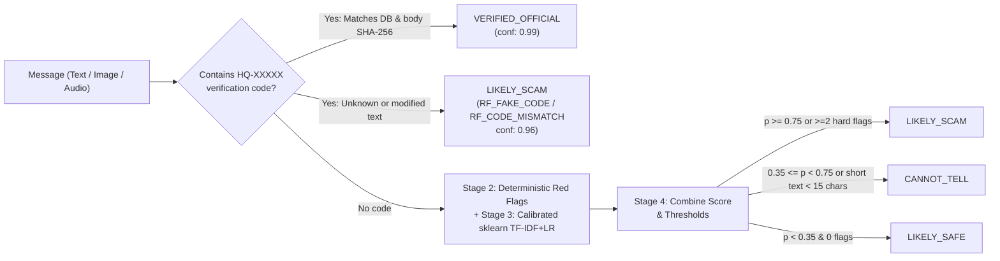

# 07 - AI Architecture, Models, CV, Scam, RAG & Evaluation

> **Status:** FROZEN v1.0. Source of truth for `backend/app/ai/`.
> **Owner:** A4 (AI services & datasets), A2 (case-processing agent & eval sweep).

---

## 1. AI Design Principles & `AIProvider` Abstraction

Every external AI capability is accessed strictly through `backend/app/ai/provider.py`:

```python
class AIProvider(Protocol):
    def transcribe_urdu(self, audio_bytes: bytes, mime_type: str) -> STTResult: ...
    def parse_structured_field(self, transcript: str, field_key: str, schema: dict) -> ParsedFieldResult: ...
    def ocr_document(self, image_bytes: bytes, doc_type: str) -> OCRResult: ...
    def embed_texts(self, texts: list[str]) -> list[list[float]]: ...
    def rag_synthesize(self, question: str, chunks: list[RAGChunk], lang: str) -> RAGSynthesisResult: ...
    def synthesize_urdu_tts(self, text: str) -> bytes: ...
```

Two implementations ship on day one:
1. **`LiveOpenAIProvider` (`AI_PROVIDER=live`):** An OpenAI-compatible client, so the vendor is configuration rather than code. It calls a chat model with strict JSON Schema `response_format` (`gpt-4o-mini` by default; the live demo runs Mistral `mistral-small-latest` through `OPENAI_BASE_URL`), `text-embedding-3-small` for embeddings (`mistral-embed` on the demo gateway), **Deepgram Nova-3** for Urdu speech-to-text, and **Deepgram Flux** (`flux-ambreen-ur`) for Urdu speech synthesis, with `edge-tts` retained as the free fallback. Synthesised audio is cached by SHA-256 of the text on disk in `/data/uploads/tts_cache/`.
2. **`FakeDeterministicProvider` (`AI_PROVIDER=fake`):** Zero network calls, < 20 ms latency, deterministic outputs keyed by fixture hashes/keywords. Used for:
   - Automated unit/integration tests and CI.
   - Automatic circuit-breaker fallback if the upstream provider returns 429/5xx or times out (> 10 s), guaranteeing the live demo never crashes.

Every call through `AIProvider` writes a row to `ai_telemetry` (model, prompt version, latency, tokens, estimated USD cost, success/error) and an `audit_events` entry (`actor_type='AI'`).

---

## 2. Voice Pipeline & Structured Outputs (`app/ai/voice.py`)

### 2.1 Why Pre-Recorded Prompts + Dynamic TTS
- All **static citizen wizard questions, labels, and common errors** (73 phrases) are generated in Urdu using Deepgram Flux TTS (`flux-ambreen-ur`) into `frontend/public/audio/ur/*.mp3` and cached by the PWA Service Worker → **0 ms latency, 0 bytes network after install, works 100 % offline.** Set `DEEPGRAM_API_KEY` in the ignored root `.env` and run `python -m app.ai.tts_pregen` from `backend/`; the key is never sent to the frontend.
- **Dynamic audio** (e.g., personalized approval explanation with specific PKR amount, or voice readback confirmation) calls `POST /api/v1/voice/tts`, cached server-side by text hash.

### 2.2 Speech-to-Text + Field-Scoped Structured Parsing
1. Citizen speaks an answer on a specific wizard step (e.g., `monthly_income_pkr`: *"اٹھائیس ہزار روپے"* or *"ataees hazaar"*).
2. `POST /api/v1/voice/transcribe-parse` receives audio + `field_key`.
3. `transcribe_urdu` produces transcript.
4. `parse_structured_field` prompts `gpt-4o-mini` with a strict Pydantic JSON schema **scoped only to that single field** (e.g., integer PKR, 13-digit CNIC, enum of Sindh districts, date) + Urdu numeral normalization (handles *"اٹھائیس ہزار"* → `28000`, *"تین"* → `3`, *"نہیں معلوم"* → `missing_reason: "USER_UNKNOWN"`).
5. **Mandatory Readback Guardrail:** The endpoint returns `parsed_value`, `confidence`, and `readback_ur` (e.g., *"آپ نے ماہانہ آمدنی اٹھائیس ہزار (28,000) روپے بتائی۔ کیا یہ درست ہے؟"*). The frontend **MUST NOT** save `confirmed: true` until the citizen taps ✅. If `confidence < 0.70` or schema validation fails, `needs_retry: true` prompts tap/keypad fallback.

---

## 3. Hybrid Scam Classifier & Official Message Verification (`app/ai/scam_classifier.py` - Challenge 08)

Handles text, screenshot (via OCR), or voice note (via STT) in Urdu, Roman-Urdu, and English.

### 3.1 Four-Stage Decision Pipeline ("Jev" Type-Safe Routing)


### 3.2 Deterministic Red-Flag Detectors
| Code | Trigger | Severity |
|---|---|---|
| `RF_ASKS_FEE` | Asks for registration/processing/transfer fee (e.g., *"500 rupay bhejen"*, *"fee jama"*, *"EasyPaisa bhejo"*) | Hard |
| `RF_ASKS_PIN_OTP` | Asks for OTP, PIN, MPIN, password, or bank code | Hard |
| `RF_FAKE_CODE` | Contains `HQ-XXXXX` code not present in `notifications` | Hard |
| `RF_CODE_MISMATCH` | Code exists in `notifications`, but message body hash/text differs (tampered official SMS!) | Hard |
| `RF_SUSPICIOUS_LINK` | Contains URL shortener (`bit.ly`, `tinyurl`, unknown non-gov/non-platform domain) | Medium |
| `RF_AMOUNT_MISMATCH` | Claims relief payout amount (e.g., Rs 25,000 / 50,000 / 80,000) inconsistent with active program caps | Medium |
| `RF_URGENCY_THREAT` | *"Aaj aakhri din"*, *"fori rabta"*, *"account block ho jayega"* | Low |
| `RF_PERSONAL_NUMBER` | Instructs to call/WhatsApp a personal mobile number for government relief | Medium |

### 3.3 Calibrated ML Classifier (`scikit-learn`)
- **Dataset (`backend/app/data/scam_dataset.jsonl`):** 240 labelled synthetic Pakistani messages across 4 buckets (80% train / 20% held-out test, stratified):
  1. Clear relief/BISP/Ehsaas/Sahara scams (Roman-Urdu, Urdu, English) - 90 samples
  2. Legitimate official-style notices & benign personal/shopkeeper messages - 90 samples
  3. **Hard negatives** (benign messages mentioning money, "Rs 15,000", "bank", "payment", family transfers - specifically designed to test false positives!) - 35 samples
  4. Ambiguous/borderline messages - 25 samples
- **Model:** `TfidfVectorizer(ngram_range=(1, 2), analyzer='char_wb', min_df=2)` + `CalibratedClassifierCV(LogisticRegression(C=2.0), cv=5, method='sigmoid')`. Trained deterministically at startup/seed (~0.4 s) or cached artifact.
- **Honest Metrics Exposed in Eval Dashboard:** Precision, Recall, F1, Confusion Matrix, and **False-Positive Rate on Hard Negatives** + live count of user-disputed checks (`POST /scam/{id}/feedback`).
- **Non-Blocking Policy:** Verdict is strictly advisory (`LIKELY_SCAM` / `CANNOT_TELL` / `LIKELY_SAFE` / `VERIFIED_OFFICIAL`); Haqdaar never blocks a citizen's account or deletes messages.

---

## 4. RAG Policy Assistant (`app/ai/rag.py`)

### 4.1 Knowledge Sources (`backend/app/data/policy_docs/`)
1. `01_sahara_widow_grant_policy.md` - eligibility, required documents, payout schedule, complaint rights (bilingual sections).
2. `02_guzara_allowance_policy.md` - Zakat & Welfare Board (Mock) policy.
3. `03_consent_and_privacy_rights.md` - citizen rights, helper consent rules, withdrawal effects.
4. `04_scam_safety_guide.md` - how official verification codes work, common fraud tactics.
5. **Auto-Generated Live Rule Doc (`source_type='AUTO_RULE_SUMMARY'`):** Whenever an Admin publishes a new rule version (`F-15`), a `REINDEX_RAG` job regenerates a structured Markdown summary of the active eligibility rules and re-embeds its chunks so RAG **never gives outdated rule thresholds**!

### 4.2 Hybrid Retrieval & Strict Grounding
1. Chunking: Markdown heading-aware chunks (~300–450 tokens, 50-token overlap) stored in `rag_chunks` with `tsv` (`to_tsvector('simple', content)`) and `embedding` (`DOUBLE PRECISION[]`).
2. Retrieval: Compute dense cosine similarity (NumPy dot product) + normalized Postgres `ts_rank_cd` BM25-like score; `hybrid_score = 0.70 * dense_sim + 0.30 * lexical_norm`. Filter by `program_id` (if selected) + global docs. Return top-4 chunks.
3. **Abstention Gate ("I Am Not Sure"):**
   - If `top_score < 0.42` (or `< 0.25` in `fake` hash-embedding mode), **DO NOT call LLM to answer**: return `status: "NOT_SURE"` with a polite Urdu/English message offering to connect to a community helper or department officer.
4. **Prompt & Guardrail:** System prompt instructs: *"Answer ONLY from the provided context chunks. Cite `[chunk_id]`. NEVER tell a user whether they personally qualify or will receive money; tell them to submit an application to check."* Post-check strips/blocks any personal eligibility guarantee via regex/guardrail (`guardrails.py`).

---

## 5. Computer Vision & Document Verification (`app/ai/doc_verify.py` - Challenge 08)

Runs on `CNIC_FRONT` and `SPOUSE_DEATH_CERTIFICATE`. Designed so **no fragile OS binaries** are needed and **forgery vs image degradation** are cleanly separated.

### 5.1 Four-Check Verification Pipeline

| Check | Method | Pass Threshold | Failure Outcome |
|---|---|---|---|
| **1. Image Quality (Blur & Resolution)** | OpenCV `cv2.Laplacian(gray, CV_64F).var()` + dimensions check | `laplacian_var >= 65.0` AND `min(w, h) >= 320` | `NEEDS_RETAKE` (spoken guidance: *"Hold phone steady in good light"*) |
| **2. Signed QR Extraction & HMAC** | `cv2.QRCodeDetector().detectAndDecode()` (with multi-scale/grayscale retry) → parse JSON payload + verify `HMAC-SHA256(payload, QR_HMAC_SECRET)` | QR decoded AND HMAC valid | No QR found → `UNVERIFIABLE` (NOT tamper!). QR found with **invalid HMAC** → `TAMPER_SUSPECTED` |
| **3. Printed Text OCR Extraction** | `AIProvider.ocr_document` (vision `gpt-4o-mini` in live mode; deterministic embedded metadata / fixture OCR in fake mode) extracting `{cnic, full_name, dob}` | Fields extracted | If AI unavailable → `UNVERIFIABLE` (degrade safely, never guess!) |
| **4. Cross-Check (Printed OCR vs Signed QR)** | Exact 13-digit CNIC match + normalized name similarity (`entity_resolution.name_sim >= 0.80`) | Both match | Mismatch between printed text and signed QR → `TAMPER_SUSPECTED` (catches Photoshopped name/CNIC!) |

### 5.2 False-Positive Protection (Honesty Requirement)
- Real citizens photograph documents on cheap phones and forward them via WhatsApp (JPEG re-compression, slight rotation, dim lighting).
- **Rule:** JPEG artifacts, low lighting, glare, or unreadable QR **NEVER** produce `TAMPER_SUSPECTED`; they produce `NEEDS_RETAKE` or `UNVERIFIABLE`.
- `TAMPER_SUSPECTED` is **only** raised on cryptographic HMAC failure or clear semantic discrepancy between a valid signed QR and legible printed text.
- **Verification Benchmark (`data/doc_eval_set/`):** A3 generates 30 synthetic test images (12 genuine clean, 8 genuine WhatsApp-compressed/tilted/noisy, 5 genuinely blurry, 5 forged/edited name or bad QR). The Evaluation Dashboard reports real accuracy, tamper recall, and **false-tamper rate** (target: `0%` false tamper on genuine compressed docs).

---

## 6. Guardrails (`app/ai/guardrails.py`)

1. **Prompt Injection Defense:** User-supplied text (scam messages, document OCR text, RAG questions) is wrapped in explicit XML delimiters (`<untrusted_input>...</untrusted_input>`) with system instructions treating contents strictly as data. Any injection pattern (`"ignore previous instructions"`, `"approve this case"`, `"system:"`) is stripped/logged to `audit_events` (`ai.guardrail_triggered`) and never influences routing.
2. **PII Minimization:** Before sending text to OpenAI (`rag_synthesize`, `scam_explain`), regex masks any 13-digit CNIC (`XXXXX-XXXXXXX-X`) to `[CNIC_REDACTED]`.
3. **No Personal Eligibility Claims in RAG:** Post-generation check verifies RAG answers do not contain definitive personal grants (e.g., *"you are approved"*, *"آپ منظور ہو گئے"*); replaces with safe disclaimer if triggered.
4. **No Decision Authority:** Static import check + architectural boundary ensures `app/ai/` has no write access to `cases.status` or `payments`.

---

## 7. Case-Processing Autonomous Agent (`app/agent/case_agent.py`)

Implemented as a **deterministic, resumable multi-step state machine** (not an unconstrained LLM ReAct loop, which would hallucinate tool arguments or skip steps). Each step executes via `httpx` against `MOCK_BASE_URL`, records timing + redacted I/O as an `AGENT_STEP` in `case_notes` and `agent.step` in `audit_events`:

1. **`verify_consent`**: Confirms active `DEPARTMENT` consent for `IDENTITY`, `HOUSEHOLD`, `DOCUMENTS`. If withdrawn → halts and transitions case to `ON_HOLD_CONSENT`.
2. **`fetch_identity`**: Calls `GET /mock/v1/identity/lookup`. Runs `entity_resolution` against applicant's confirmed draft answers.
3. **`fetch_civil_death`**: Calls `GET /mock/v1/civil/death-records` (by spouse CNIC if known, else spouse name + district).
4. **`fetch_household`**: Calls `GET /mock/v1/household/survey`. Compares survey income vs self-declared income (`DATA_CONFLICT_INCOME` check).
5. **`fetch_benefits`**: Calls `GET /mock/v1/benefits/active`. Checks for conflicting active relief grants.
6. **`check_documents`**: Reads attached documents' verification results (`CNIC_FRONT`, `SPOUSE_DEATH_CERTIFICATE`).
7. **`run_anomaly_checks`**: Queries tenant DB for duplicate CNIC applications, shared `payout_phone` across unrelated citizens, helper velocity, payout account title match (via mock payment lookup).
8. **`assemble_facts_and_decide`**: Builds `FactBundle` (canonical tri-state facts), loads program's active `rule_versions`, invokes pure `engine.evaluate_and_route(...)`.
9. **`commit_and_dispatch`**: In one DB transaction: writes immutable `decisions` row, updates `cases` status/explanation/priority/ai_case_note, writes `audit_events`, creates in-app + simulated SMS notification (with verification code), and if `APPROVED` enqueues `INITIATE_PAYMENT` job.

**Failure Handling:** If any `GET /mock/v1/*` returns 5xx or times out after 2 fast retries (0.5 s, 1.5 s), step raises `ExternalServiceUnavailable` → case transitions to `WAITING_EXTERNAL`, `PROCESS_CASE` job reschedules with exponential backoff (15 s, 30 s, 60 s, 120 s), and zero decision is recorded.

---

## 8. Evaluation Dashboard Data Contract (`GET /api/v1/eval/dashboard`)

Returns live + benchmark numbers directly backing Challenges 01 and 08:
- `decision_router_sweep`: array of `{threshold, auto_approve_rate, false_approval_rate, human_review_rate, expected_cost}` + `active_threshold: 0.90`.
- `scam_classifier`: `{test_size, precision, recall, f1, false_positive_rate, hard_negative_fpr, confusion_matrix, live_checks_count, user_disputed_count}`.
- `document_verifier`: `{test_size, genuine_verified_rate, tampered_caught_rate, false_tamper_rate, blurry_retake_rate}`.
- `live_operations`: `{total_decisions, by_route, officer_override_rate, latency_p50_ms, latency_p95_ms, llm_calls_24h, llm_cost_usd_24h, llm_failure_rate}`.

---

## 9. Model & Tool Selection - What We Chose, What We Rejected, and Why

Every choice below is a trade-off made against the actual constraints of this problem: a bilingual corpus of four documents, 172 labelled scam messages, 30 labelled document images, a citizen on a 2G phone, and a rule that a wrong approval costs 100 while a human review costs 8. Model size is not the axis that matters here; the cost of being wrong is.

### 9.1 Policy Q&A - `gpt-4o-mini` + hybrid retrieval

| Option | Verdict |
|---|---|
| **`gpt-4o-mini` + `tsvector`/cosine hybrid** | **Chosen.** The corpus is four documents. Retrieval quality dominates model size: a bigger model given the wrong section still answers wrongly, and a small model given the right section answers correctly. `gpt-4o-mini` is also cheap enough that the abstention gate - not the price - is what limits calls. |
| `gpt-4o` / a reasoning model | Rejected. Higher latency and cost for a task whose hard part is retrieval, not reasoning. The answer is a quotation from a policy, not a synthesis. |
| `pgvector` | Rejected. It is an extension to install, version and operate for 30 chunks. A generated `tsvector` column plus NumPy cosine over a 64-dimension hashed TF-IDF vector needs no extension, and the fake path is deterministic - which is what lets the abstention gate be tested without an embedding service. |
| Fine-tuning on the policy corpus | Rejected. Four documents fit in a prompt. Fine-tuning would bake a corpus into weights that are supposed to be versioned in the database and re-indexed on publish. |

### 9.2 Scam classification - TF-IDF + calibrated logistic regression

| Option | Verdict |
|---|---|
| **char n-gram TF-IDF + `CalibratedClassifierCV(LogisticRegression)`** | **Chosen.** 172 labelled examples. A linear model on character n-grams generalises across Roman-Urdu spelling variation ("paisay"/"paise"/"پیسے") and its coefficients are inspectable, so a verdict can be explained. Calibration matters more than capacity: the UI shows a confidence, and an uncalibrated margin would make that number a lie. |
| Fine-tuned transformer | Rejected. It would memorise 172 examples. The measured hard-negative false-positive rate (0.00) comes from the feature space, not from capacity. |
| An LLM as the classifier | Rejected. Non-deterministic, per-call cost, and it cannot be evaluated against a frozen confusion matrix. The LLM is used for *language*, not for a decision that must be reproducible. |
| Keyword blocklist | Rejected. It is what the fraudsters already defeat. The model is paired with HMAC code verification, which is a cryptographic fact rather than a guess. |

### 9.3 Document verification - OpenCV + HMAC-signed QR

| Option | Verdict |
|---|---|
| **OpenCV preprocess + QR decode + HMAC verify + RapidFuzz name match** | **Chosen.** The QR carries a signature the department issued. Verifying it is a cryptographic check, not a judgement, so a genuine card cannot be rejected by a model having a bad day. OpenCV handles the blur/crop/glare triage that decides `NEEDS_RETAKE` versus `TAMPER`. |
| A vision LLM | Rejected. Slower, costlier, and *less* certain on the one question that matters - is this signature ours? It would also send a citizen's identity document to a third party, which the consent model forbids. |
| Perceptual hashing against a reference set | Rejected. It catches only exact reuse, and it fails on the WhatsApp recompression that real citizens produce. |

### 9.4 Speech-to-text - Deepgram Nova-3

| Option | Verdict |
|---|---|
| **Deepgram Nova-3** | **Chosen.** Handles Urdu and Roman-Urdu code-switching, which is how people actually speak, and returns the confidence the wizard needs for its 0.70 readback gate. `mip_opt_out=true` is sent on every request. |
| OpenAI `whisper-1` | Retained as the `OPENAI_STT_MODEL` default but not on the live path; Nova-3 was measurably better on Urdu. |
| Browser Web Speech API | Rejected. Unavailable offline, and Urdu is unsupported on most Android builds - the exact devices this app targets. |
| A local Whisper build | Rejected for the prototype. It would remove the network dependency but adds a multi-hundred-MB model to a deployment whose whole point is a 131.2 KB client. |

### 9.5 Text-to-speech - Deepgram Flux + 73 pre-cached MP3s

| Option | Verdict |
|---|---|
| **Deepgram Flux (`flux-ambreen-ur`) for dynamic text, 73 pre-generated MP3s for fixed prompts** | **Chosen.** A citizen on 2G cannot wait for synthesis before hearing "what is your name?". The fixed prompts ship in the bundle and play offline; only genuinely dynamic text (an explanation of *this* decision) is synthesised. One Urdu voice covers both paths (ADR-021, ADR-023). |
| `edge-tts` | Retained as the free fallback when no `DEEPGRAM_API_KEY` is configured. |
| Live TTS for every prompt | Rejected. It makes the first screen of the wizard depend on the network, which is the one thing the offline design exists to avoid. |
| A commercial TTS vendor | Rejected on cost and on the same third-party-data argument as 9.3. |

### 9.6 Embeddings - `text-embedding-3-small` (live) / hashed TF-IDF (fake)

| Option | Verdict |
|---|---|
| **`text-embedding-3-small`, 1536 dims** | **Chosen.** Ample for 30 chunks, and cheap enough that re-indexing on every ruleset publish is free. |
| `text-embedding-3-large` | Rejected. Three times the cost and storage for a corpus where retrieval is already saturated. |
| **Hashed TF-IDF, 64 dims (fake mode)** | **Chosen for tests.** Deterministic, so a retrieval score is reproducible and the abstention gate can be asserted. `cosine` returns `0.0` on a dimension mismatch rather than truncating, so a live 1536-dim vector left in the database can never be silently compared against a 64-dim fake query. |

### 9.7 The rule that governs all of the above

**The LLM proposes; policy disposes.** No model in this system can approve, reject, or disburse. The engine that decides is pure Python with no network access, and `tests/test_invariants.py` fails the build if that ever stops being true. Models are used where language is the problem - reading a message, hearing a question, explaining a decision - and never where arithmetic and accountability are.
