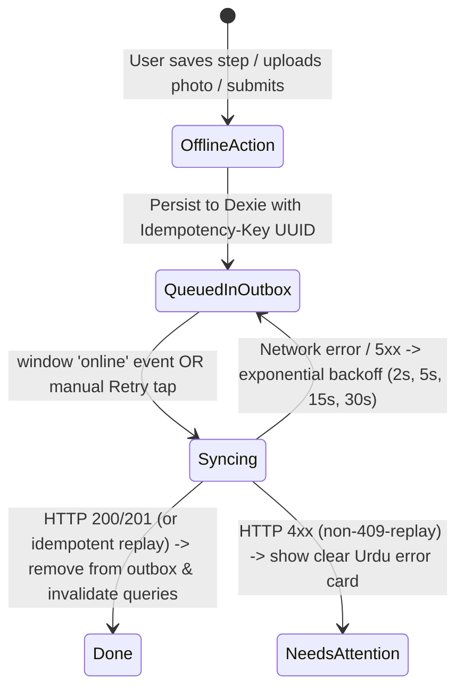

# 11 — UX, Accessibility, Low-Bandwidth PWA & Console Specifications

> **Status:** FROZEN v1.0. Source of truth for `frontend/`.
> **Owners:** A5 (`shared/`, `citizen/`, `helper/`), A6 (`staff/`).

---

## 1. Two-Speed Frontend Architecture (Route-Split Single SPA/PWA)

To serve both a low-literacy widow on a 2G/Slow-3G phone **and** a department officer/auditor on a laptop from one cohesive app without bloating the citizen's download:

| Surface | Routes | Owner | Bundle Budget | Language & Direction |
|---|---|---|---|---|
| **Citizen & Helper PWA** | `/`, `/c/*`, `/h/*`, `/scam-check`, `/help`, `/transparency` | A5 | **≤ 150 KB JS gzipped** (first load ≤ 300 KB total) | **Urdu (`ur`, `dir="rtl"`) default** with 1-tap toggle to English (`en`, `dir="ltr"`) |
| **Staff Consoles** | `/staff/*`, `/admin/*`, `/auditor/*` | A6 | Lazy-loaded (`React.lazy` separate chunks) | English (`dir="ltr"`) with inline Urdu explanation preview |

### Global Prototype Banner (Mandatory — RULE-5)
Rendered persistently at the top of every route (compact 28 px amber bar):
- **ur:** `پروٹوٹائپ — یہ سرکاری سروس نہیں ہے۔ تمام شناختی اور ادائیگی کے نظام نقلی ہیں۔` + `[تفصیلات]` (`/transparency`)
- **en:** `PROTOTYPE — Not an official government service. Identity, payment & data services are simulated.` + `[Real vs Simulated]`

---

## 2. Low-Literacy & Accessibility Design Rules (Challenge 07)

Non-negotiable rules enforced across all `/c/*` and `/h/*` screens:
1. **One task / one question per screen.** No multi-field vertical forms in the citizen wizard.
2. **Audio-first:** Every screen displays a prominent 🔊 button (56×56 px) playing pre-cached Urdu MP3 prompts (`public/audio/ur/<step>.mp3`). An optional "Auto-read screens" toggle (ON by default for citizens) plays the prompt once on navigation.
3. **Icons + colour + text:** Statuses NEVER rely on colour alone:
   - Approved: Green + Checkmark + Coin pictogram
   - Needs Info: Amber + Camera/Question pictogram
   - Officer Reviewing: Blue + Person-with-Badge pictogram
   - Waiting External: Grey/Blue + Clock/Cloud pictogram
   - Consent Paused: Purple + Lock pictogram
   - Rejected: Red + Cross pictogram
4. **Touch & Contrast:** All tap targets ≥ 48×48 px (primary actions ≥ 56 px tall); WCAG AA contrast ≥ 4.5:1; readable Urdu font (**Decision, ADR-023:** use **`Noto Nastaliq Urdu`** for the citizen UI — Nastaliq is the script Urdu is written in, and the earlier `Noto Sans Arabic` choice rendered Urdu in a Naskh face that reads as Arabic rather than Urdu. The subset is 194 KB WOFF2, self-hosted and precached, and the type scale gives it ~1.9 leading under `html[lang='ur']` because Nastaliq hangs its descenders far below the baseline. The subset MUST retain the Arabic joining features `init`/`medi`/`fina`/`isol`; without them the font loads but every word renders letter-by-letter).
5. **Voice is an accelerator, never a single point of failure:** Every step offers tap choices / numeric keypad / large `+` / `–` counter alongside the 🎤 Speak button.
6. **Mandatory Voice Readback:** After speaking, a large confirmation card shows the parsed value, plays Urdu audio readback (*"آپ نے 28,000 روپے بتایا۔ کیا یہ درست ہے؟"*), and offers only two giant buttons: ✅ Yes / ❌ Try Again.
7. **Lite Mode:** Toggle in top bar (auto-enabled if `navigator.connection.saveData === true` or `effectiveType === '2g'|'slow-2g'`). Strips decorative illustrations, uses inline SVG icons (< 1 KB each), and disables non-essential polling.

---

## 3. Citizen PWA Flows (`/c/*`) — Owner: A5

### 3.1 Citizen Home (`/c`)
Four giant pictogram tiles (2×2 grid, each with 🔊 audio label):
1. **Apply for Grant** (`درخواست دیں`) → Wizard (`/c/apply`)
2. **My Applications** (`میری درخواستیں`) → Status cards + timeline + audio explanation (`/c/cases`)
3. **Check a Message (Scam)** (`پیغام چیک کریں`) → Scam Checker (`/scam-check`)
4. **My Data & Permissions** (`میرا ڈیٹا اور اجازت`) → Consent Center & My Data (`/c/consent`)
Plus a bottom floating button: **Ask a Question** (`سوال پوچھیں` → RAG Policy Assistant `/c/ask`).

### 3.2 Guided Application Wizard (`/c/apply/:caseId`)
Progress dots at top (no dense text). Steps:
1. **Consent Gate:** Audio + pictograms explaining who receives data (`Social Protection Dept`), what categories, why, and that she can take it back anytime. Tap ✅ Grant to proceed.
2. **Full Name** (🎤 Speak or type)
3. **CNIC (13 digits)** (Large 0–9 visual keypad with `XXXXX-XXXXXXX-X` grouping + 🎤 Speak)
4. **Date of Birth / Age** (Year selector / keypad + 🎤 Speak)
5. **Husband's Name** (🎤 Speak or type)
6. **Husband's CNIC** (Keypad + prominent **"I don't know" (`مجھے نہیں معلوم`)** button!)
7. **District** (Icon/card list of Sindh districts with audio labels)
8. **Children under 18** (Giant `–` `[ 3 ]` `+` counter + 🎤 Speak)
9. **Household Size** (Giant `–` `[ 4 ]` `+` counter)
10. **Monthly Household Income** (Tap bands `< 20k`, `20k–30k`, `30k–40k`, `> 40k` OR exact keypad + 🎤 Speak)
11. **Payout Mobile Number (Raast)** (Keypad, pre-filled with own login phone as 1-tap option)
12. **Photo: CNIC Front** (Camera capture / file picker → client-side canvas compression ≤ 1280 px, ≤ 250 KB → immediate blur/QR verification feedback; if `NEEDS_RETAKE`, speaks retake instructions!)
13. **Photo: Husband's Death Certificate** (Same compression + verification; optional skip if citizen taps "Not with me right now" so civil registry check can still run!)
14. **Audio Review & Submit:** Plays summary, giant ✅ **Submit Application** button (works offline via Outbox!).

### 3.3 Consent Center (`/c/consent`) & My Data (`/c/my-data`)
- **Who has my data:** Cards for Department and each Helper with toggleable categories and big red **Withdraw Access (`اجازت واپس لیں`)** button.
- Withdrawing Department access with an open case displays a clear spoken confirmation modal explaining the case will pause (`ON_HOLD_CONSENT`).
- **Who viewed my data (Access Log):** Chronological list with green ✅ Allowed and red 🚫 **Blocked** badges (so Fatima sees blocked helper/officer attempts live!).
- **My Data:** Grouped facts with source badge (`Self-declared` vs `Registry`) + **Request Correction** button.

### 3.4 Scam Checker (`/scam-check` — Public + Logged-in)
- Accessible directly without login (for Shopkeeper Rasool).
- Three input tabs: **Paste Text**, **Upload Screenshot**, **Speak Message**.
- Big traffic-light + icon verdict card + Urdu audio playback:
  - 🟢 **Verified Official Message** (shows matched official notification timestamp & program)
  - 🔴 **Likely Scam** (lists exact red flags in Urdu/English bullets)
  - 🟡 **Cannot Tell — Be Careful** (safety checklist: never share PIN or pay fees)
  - 🟢 **Likely Safe** (with reminder to still never share OTPs)
- Honest feedback link at bottom: **"I think this result is wrong"** → calls `POST /api/v1/scam/{id}/feedback`.

---

## 4. Helper Mode (`/h/*`) — Owner: A5 (Bonus Feature)

Designed for **Ayesha serving 40 families on one shared phone**:
1. **Family Roster (`/h`):** Searchable list of families with colour-coded avatar circles, name, masked CNIC, active case badge, consent status (`Active` / `Expired — Renew`), and 🔊 play-name button.
2. **Add Family (`/h/new`):** Captures basic profile + **Consent Capture Choice**:
   - **Recommended:** Citizen's own phone OTP (high assurance `CITIZEN_OTP`).
   - **Fallback (no own phone):** Witnessed verbal consent — records a 5–10 s Urdu audio clip of the citizen consenting + helper attestation checkbox (`VERBAL_WITNESSED`, explicitly warns that officer review will be required).
3. **Safe Context Switch (≤ 2 Taps):**
   - Tapping a family **synchronously wipes** TanStack Query cache (`queryClient.clear()`) and active in-memory wizard state, sets `actForCitizenId`, and opens a full-screen confirmation interstitial:
     - Large colour avatar + **"You are now helping Fatima Bibi (`اب آپ فاطمہ بی بی کی مدد کر رہی ہیں`)"** + plays audio cue + single **Continue** button.
   - Every `/c/*` screen while in Helper Mode displays a persistent coloured top strip showing the active citizen's avatar + name + a 1-tap **Switch Family** button.

---

## 5. Offline-First & Low-Bandwidth Architecture (`frontend/src/shared/offline/`)

### 5.1 Service Worker (`vite-plugin-pwa` / Workbox)
- **Precache:** App shell HTML/JS/CSS for citizen routes + all `public/audio/ur/*.mp3` + SVG icons.
- **Runtime Cache:** `GET /api/v1/programs` (`StaleWhileRevalidate`), `GET /api/v1/cases` (`NetworkFirst` with IndexedDB fallback).

### 5.2 IndexedDB Schema (`Dexie.js`)
- `drafts`: `{ localId, serverCaseId, citizenId, programId, wizardStep, answers, updatedAt }`
- `outbox`: `{ id (UUID = Idempotency-Key), createdAt, citizenId, actForCitizenId, method, path, body, blobRef, status: 'PENDING'|'SYNCING'|'FAILED', attempts, lastError }`
- `cachedCases`: `{ id, citizenId, data, etag, fetchedAt }`

### 5.3 Outbox Sync State Machine

- Top status pill indicates: 🟢 Online · 🟡 Offline (X items saved locally — will send automatically) · 🔄 Syncing...
- Guarantees zero lost drafts and **exact-once** submission on reconnect (tested by `offline_sync.spec.ts`).

---

## 6. Staff Consoles (`/staff/*`, `/admin/*`, `/auditor/*`) — Owner: A6

### 6.1 Officer Workspace (`/staff/queue`, `/staff/cases/:id`)
- **Queue Table:** Sort tabs (`Priority` default, `Lowest Confidence`, `Oldest`), filters (`Status`, `Flag`, `Assigned to me`, `Awaiting 2nd Approval`), colour-coded priority band badges, weakest confidence score bar, top escalation reason chips, stale-rule warning icon.
- **Case Review Screen (2-Column Layout):**
  - **Left (Evidence):** AI Case Handoff Card (Verified / Uncertain / Suggested Checks), Canonical Facts Table with source badges & conflict highlights, Rule Evaluation Trace (`PASS`/`FAIL`/`UNKNOWN`), Uploaded Documents viewer with CV check breakdown (Blur score, QR HMAC badge, OCR-vs-QR diff), Active Risk Flags, Agent Step Timeline.
  - **Right (Decision Panel):** Stale-rule banner (*"Evaluated with v1; v2 active — Re-evaluate"*), Action buttons (`Assign to Me`, `Approve`, `Request Info`, `Reject`, `Escalate`), mandatory Reason Code checkboxes + Note box for Reject/Approve-with-flags, Four-eyes indicator (*"HIGH flag present: your approval sends to a second officer"*).
  - If citizen withdrew consent while officer had page open: crisp `403 CONSENT_REVOKED` banner hides all PII and shows *"Citizen withdrew consent — access blocked and logged."*

### 6.2 Admin Console (`/admin/*`)
1. **Rule Editor (`/admin/rules`):** Program selector, version list with SHA-256 hashes & change notes, visual form editor for each rule (`fact`, `op`, `value`, `on_fail`, `on_unknown`, Urdu/English reasons) + benefit formula + confidence threshold + read-only JSON preview. Buttons: **Save Draft**, **Validate**, **Simulate (Digital Twin)**, **Publish**.
2. **Digital Twin Drawer/Page (`/admin/rules/:id/twin`):** Side-by-side before/after outcome chart (`APPROVED` / `NEEDS_INFO` / `HUMAN_REVIEW`), prominent **Budget Delta (PKR)** KPI card, filterable table of every flipped historical case with exact reason why it flipped.
3. **Users & API Keys (`/admin/users`, `/admin/api-keys`):** CRUD tables; API key creation modal shows plaintext key once with copy button.
4. **Mock Services & Jobs (`/admin/mocks`, `/admin/jobs` — Platform Admin):** Live toggle cards for all 7 mock DPI services (`NORMAL` / `SLOW` / `FLAKY` / `DOWN`, latency slider, failure rate), Jobs queue table with retry button, and **Demo Reset** button (with confirmation).

### 6.3 Auditor Console (`/auditor/*` — Strict Read-Only)
1. **Audit Event Stream (`/auditor/events`):** Filter by case, actor type (`USER`/`AI`/`AGENT`/`SYSTEM`), action, tenant, date.
2. **Chain Integrity Banner:** Prominent **Verify Hash Chain** button → displays *"Chain Intact: X,XXX events verified"* (or highlights exact tampered `seq`).
3. **Decision Trace Inspector (`/auditor/cases/:id`):** Complete JSON + visual view of `input_snapshot_json` + hash, `rule_version` + hash, `model_versions`, 4-pillar confidence breakdown, rule trace, agent steps, and citizen explanation.
4. **Consent Audit (`/auditor/consents`):** Full history of grants, withdrawals, and allowed/denied access logs.

### 6.4 Evaluation & Analytics Dashboards (`/staff/eval`, `/staff/analytics`)
- **Evaluation Dashboard (Challenge 01 & 08 centerpiece):**
  - Interactive **Threshold Sweep Chart** (`Recharts` or lightweight SVG chart): X-axis = confidence threshold `0.50–0.95`, lines for Expected Cost, False Approval Rate, and Human Review Load, vertical marker at active `0.90`.
  - **Scam Classifier Card:** Precision, Recall, Confusion Matrix, **Hard-Negative False Positive Rate**, and live user-disputed count.
  - **Document Verifier Card:** Genuine verified rate, Tamper catch rate, **False Tamper Rate (0 %)** on WhatsApp-compressed genuine docs.
  - **Live Ops KPIs:** Route distribution, officer override rate, p50/p95 pipeline latency, LLM calls/cost/failure rate.
- **Tenant Analytics (`/staff/analytics`):** Per-tenant applications, approval rate, PKR disbursed, avg turnaround time, top risk flags.

### 6.5 Demo Support Pages (`/transparency`, `/staff/device-sim`)
- **`/transparency`:** Clean table of **Real vs Simulated** components, synthetic data guarantee, current mock service modes, and link to Swagger `/api/docs`.
- **`/staff/device-sim` (Simulated SMS Phone Inbox):** Select any persona phone (`Fatima`, `Rasool`, etc.) to view live OTPs and official payment SMS with copyable `HQ-XXXXX` verification codes!
