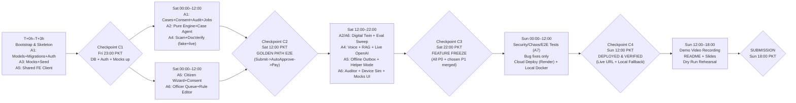

# 12 - 48-Hour Execution & Multi-Agent Coordination Plan

> **Status:** FROZEN v1.0.
> **Build Window:** Friday, 20 Nov 2026, 18:00 PKT → Sunday, 22 Nov 2026, 18:00 PKT (**~46.5 hours remaining** from planning completion).
> **Final Live Evaluation:** Monday, 23 Nov 2026, FAST-NUCES Karachi Library.
> **Principle:** Vertical-slice integration first. A working, tested, deployed P0+P1 platform beats an unintegrated pile of P2 features.

---

## 1. Team / Agent Topology

Seven specialized coding agents + one human/coordinating **Integration Lead** (you / orchestrator) who owns merges, checkpoint sign-offs, and scope cuts:

| Agent | Role | Primary Ownership |
|---|---|---|
| **A1** | Core Backend Platform | FastAPI shell, DB + Alembic migrations, Auth/JWT/OTP, RBAC, Tenants, Consent engine, Cases CRUD & state machine, Audit chain, Jobs worker, Notifications, Public API + Swagger |
| **A2** | Decision Engine & Case Agent | Pure `app/engine/` (Rules DSL, Evaluator, Confidence, Router, Entity Resolution, Anomalies, Digital Twin, Explainer, Eval Sweep) + `app/agent/case_agent.py` + Rule/Eval APIs |
| **A3** | Mock DPI & Synthetic Data | `app/mocks/` (7 simulated services + chaos controls), `seed.py` (personas, 2 tenants/programs, 60+ historical cases), `doc_generator.py` (signed QR mock CNICs/death certs), `eval_cases.jsonl`, Demo Reset |
| **A4** | AI Services | `app/ai/` (`AIProvider` live/fake, Urdu Voice STT/TTS + structured parser, OpenCV+QR+OCR document verifier, hybrid scikit-learn Scam Classifier + dataset, hybrid RAG + policy docs, guardrails, telemetry) |
| **A5** | Citizen & Helper PWA | `frontend/src/shared/` (API client, Dexie offline outbox, i18n ur/en, audio player) + `citizen/` (wizard, status, consent center, my-data, scam checker, policy Q&A) + `helper/` (family roster, safe switcher) |
| **A6** | Staff Consoles | `frontend/src/staff/` (Officer queue & case review, Admin rule editor + Digital Twin + users/keys/mocks/jobs, Auditor console + chain verify, Eval & Analytics dashboards, Transparency, Device Simulator) |
| **A7** | QA, DevOps & Integration | `docker-compose.yml`, Render Dockerfile/deploy, CI/invariant checks, Security/RBAC/Consent/Chaos test suites, Playwright E2E (golden path + offline sync), Demo rehearsal script |

---

## 2. Critical Path & Dependency Graph

---

## 3. Phase-by-Phase Schedule (PKT)

### Phase 1 - Foundation & Contracts Bootstrap (`Fri 19:30 – Fri 23:30`, 4 h)
- **Goal:** Every agent can run against a live local Postgres + FastAPI + Vite dev stack with real migrations, demo auth, and mock services.
- **Parallel Work:**
  - **A1:** Repo skeleton (`backend/pyproject.toml`), `config.py`, `db.py`, ALL ORM models (`04-data-model.md`), initial Alembic migration, Auth (`/auth/otp/*`, `/auth/login`, `/auth/demo-login`, `/auth/me`), RBAC + Tenant deps, Audit writer, Health endpoint.
  - **A2:** Complete `app/engine/` pure Python package (`rules_dsl.py`, `evaluator.py`, `confidence.py`, `router.py`, `entity_resolution.py`, `anomalies.py`, `explainer.py`) + comprehensive unit tests (zero DB dependency - 100 % parallelizable immediately!).
  - **A3:** `app/mocks/` router (all 7 mock DPI endpoints + chaos middleware), `doc_generator.py` (mock CNIC/death cert pack), `seed.py` (tenants, users, personas, Sahara v1 + Guzara v1 rules, mock registry data).
  - **A4:** `AIProvider` interface + `FakeDeterministicProvider` + `LiveOpenAIProvider` skeleton, `scam_dataset.jsonl` (240 labelled messages) + `scam_classifier.py`, `doc_verify.py` (OpenCV blur + QR HMAC + OCR cross-check).
  - **A5:** `frontend/` Vite + React + Tailwind + PWA setup, `shared/` (typed API client, auth store, PrototypeBanner, i18n ur/en, Dexie schema), Demo Persona Login page, Citizen Home shell.
  - **A6:** Staff layout shell (sidebar, role guard, Transparency page, Device Simulator SMS inbox UI) - wired to `/api/v1` types.
  - **A7:** `docker-compose.yml` (`db`, `api`, `worker`), `.env.example`, pytest conftest + architectural invariant test script (`test_invariants.py`).
- **Checkpoint C1 (`Fri 23:30 PKT`):** `docker compose up` boots cleanly; `alembic upgrade head` & `seed.py` succeed; all 9 personas can demo-login; `pytest backend/tests/engine` passes 100 %; `/mock/v1/identity/lookup` returns Fatima Bibi.

### Phase 2 - Golden Path & Core Platform P0 (`Sat 00:00 – Sat 12:00`, 12 h, incl. sleep rotation)
- **Goal:** Complete end-to-end working platform covering all 5 roles and core requirements.
- **Parallel Work:**
  - **A1:** Consent enforcement engine (`security/consent.py` with isolated-session denied logging!), Consent endpoints, Cases CRUD/draft/submit/withdraw, Document upload/download with consent check, Postgres `SKIP LOCKED` job worker (`PROCESS_CASE`, `INITIATE_PAYMENT`), Officer endpoints (queue, assign, decide, four-eyes), Auditor endpoints (`events`, `trace`, `consents`, `verify-chain`), Public API + API Keys + Swagger examples.
  - **A2:** `app/agent/case_agent.py` wired to `/mock/v1/*` via `httpx`, Rule Editor CRUD/validate/publish endpoints, Digital Twin (`engine/twin.py`) + `eval_sweep.py`.
  - **A3:** Expand `seed.py` to generate 60 historical decided cases + 6 showcase queue cases (`HQ-2026-000101..106`) + `eval_cases.jsonl` (120 labelled cases) + `doc_eval_set/` (30 images) + `/admin/demo/reset`.
  - **A4:** Wire `/scam/check` + `/scam/{id}/feedback`, `/documents` verification hook, `voice.py` (`/voice/transcribe-parse`, `/voice/tts`), pre-generate 45 static Urdu prompt MP3s into `frontend/public/audio/ur/`.
  - **A5:** Complete Citizen Application Wizard (all 14 icon+audio screens + canvas image compression + retake feedback), Citizen Status & Explanation screen (with audio), Consent Center (grant/withdraw + blocked access log), Public Scam Checker UI.
  - **A6:** Officer Review Queue + full Case Review screen (AI handoff card, facts, rule trace, doc checks, decide + four-eyes), Admin Rule Editor (form + validate + publish), Auditor Console (events, trace inspector, verify chain button).
  - **A7:** Write & run P0 integration test suite (`test_golden_path.py`, `test_rbac_matrix.py`, `test_consent_enforcement.py`).
- **Checkpoint C2 (`Sat 12:00 PKT` - CRITICAL GATE):** Live walkthrough works end-to-end: Fatima submits → agent checks mocks → auto-approved → Raast payment → SMS with verification code arrives in Device Sim → Rasool verifies code + catches fake scam → Fatima withdraws consent → officer blocked & logged → Bilal edits rule → Nadia verifies hash chain.

### Phase 3 - Differentiators, Bonus Features & Live AI (`Sat 12:30 – Sat 22:00`, 9.5 h)
- **Goal:** Ship all high-value P1 differentiators and switch on `AI_PROVIDER=live` with verified fallback.
- **Parallel Work:**
  - **A1:** My Data + Correction Requests endpoints, Payment-not-received Complaint flow (`CHECK_COMPLAINT`), Rate limiter middleware, Tenant Analytics endpoint, `REINDEX_RAG` trigger on rule publish.
  - **A2:** Complete `/eval/dashboard` aggregating live ops + `eval_sweep` + scam/doc benchmarks; officer stale-rule re-evaluation endpoint; anomaly tuning.
  - **A3:** Verify 2nd tenant (`ZWB` / `GUZARA_ALLOWANCE`) end-to-end; verify chaos modes (`DOWN`/`FLAKY`/`SLOW`) cleanly trigger `WAITING_EXTERNAL` and recover.
  - **A4:** Complete RAG Policy Assistant (`/rag/ask` with 4 Markdown policy docs + auto-rule-summary re-index + `NOT_SURE` abstention + guardrails); run live OpenAI verification (`whisper-1`, `gpt-4o-mini`, `text-embedding-3-small`) and benchmark metrics.
  - **A5:** **Helper Mode** (family roster, OTP + verbal witnessed consent, safe ≤ 2-tap switcher with cache wipe & confirmation interstitial), **Offline-First Sync** (Workbox precache + Dexie outbox + `Idempotency-Key` replay + Lite mode toggle), RAG "Ask a Question" UI, My Data UI, verify citizen bundle ≤ 150 KB gzipped.
  - **A6:** **Digital Twin UI** (outcome chart + budget delta + flipped cases table), **Evaluation Dashboard UI** (threshold sweep curve + scam/doc FPR cards + live ops), **Tenant Analytics UI**, Admin Users / API Keys / Mock Chaos Controls / Jobs UI.
  - **A7:** Chaos tests (`test_mock_outage.py`), Digital Twin & Rule Versioning tests, AI eval tests, Playwright E2E (`golden_path.spec.ts`, `offline_sync.spec.ts`), Render staging deployment.
- **Checkpoint C3 (`Sat 22:00 PKT` - STRICT FEATURE FREEZE):** No new features started after Sat 22:00. Any incomplete P1/P2 feature is cut cleanly (see §4).

### Phase 4 - Stabilization, Security Audit & Deployment (`Sun 00:00 – Sun 12:00`, 12 h, incl. sleep)
- Fix every failing test, UI glitch, RTL alignment issue, and edge case found in Phase 3.
- Run full Security & RBAC checklist (`13-testing-and-quality.md`), verify `DEMO_MODE=false` hides demo login, verify zero PII in logs, verify audit hash chain integrity after full workflow.
- Deploy final build to **Render** (public HTTPS link) AND verify local `docker compose up` fallback on demo laptop.
- **Checkpoint C4 (`Sun 12:00 PKT`):** Deployed link live, `/health` green, `/api/docs` live, all 8 demo scenes verified on BOTH Render and local Docker.

### Phase 5 - Video, README, Slides & Rehearsal (`Sun 12:00 – Sun 18:00`, 6 h)
- Record crisp 4–5 minute demo video showing live deployed system, upload to public Google Drive (verify incognito access!).
- Finalize `README.md` (with exact Real vs Simulated table, architecture diagram, deployed link, Swagger link, test instructions).
- Optional 6-slide presentation deck for Monday Q&A.
- Run 2 timed live demo rehearsals + Q&A stress test (`15-demo-and-submission.md`).
- **Checkpoint C5 (`Sun 18:00 PKT` - SUBMISSION DEADLINE):** Submit GitHub link, deployed link, Google Drive video link, and slides.

---

## 4. Explicit Scope Cut Rules (Decided Now, Not in Panic)

If behind schedule at **C2 (Sat 12:00)** or **C3 (Sat 22:00)**, cut in this exact order:
1. **Cut first (P2):** Scam Map (`F-26`), Webhooks (`F-28`), Free-form LLM assistant (`F-31`).
2. **Cut second (P1 low-risk):** Scam image/audio upload tabs (keep text + official code verification), Dynamic TTS for arbitrary text (keep pre-recorded Urdu prompts for all wizard/status screens), My Data correction requests (`F-12`, keep read-only My Data + Consent Center).
3. **Cut third (only if critical):** Payment complaint automation (`F-09` complaint sub-flow - keep payment + SMS code).
4. **NEVER CUT (Core Winning Identity):**
   - Citizen icon+audio wizard & golden path (`F-03`, `F-05`, `F-06`, `F-10`)
   - Decision Engine + Cost Matrix + Eval Threshold Sweep (`F-06`, `F-22`)
   - Officer Queue + Human Handoff + Four-Eyes (`F-07`, `F-08`)
   - Dynamic Rule Editor + Versioning + Digital Twin (`F-15`, `F-16`)
   - Server-Side Consent Enforcement + Blocked Access Log (`F-11`)
   - Hash-Chained Audit Log + Auditor Trace (`F-18`)
   - Helper Mode Safe Switcher (`F-13`) + Offline Outbox (`F-24`)
   - Scam Checker + Verification Codes + Signed-QR Doc Verification (`F-14`, `F-04`)
   - Mock Services + Chaos Mode (`F-17`, `F-29`) + Public API Swagger (`F-19`)

---

## 5. Multi-Agent Integration Protocol

1. **Branching:** Each agent works on `feat/<agent>-<slice>` (e.g., `feat/a2-engine`) branched from `main`. Pull `main` before every PR/merge.
2. **No Silent Contract Edits:** If any agent needs to change a field name, table column, or endpoint path from docs `04`/`05`, they MUST stop and request an update to [17-decision-log.md](17-decision-log.md) and `04`/`05` from the Integration Lead first.
3. **File Ownership Enforcement:** Agents never modify files outside their owned paths in [14-agent-playbooks.md](14-agent-playbooks.md).
4. **Every Merge Runs Gate:** `ruff check`, `pytest backend/tests/engine backend/tests/invariants`, and `npm run typecheck` must pass before merging to `main`.
